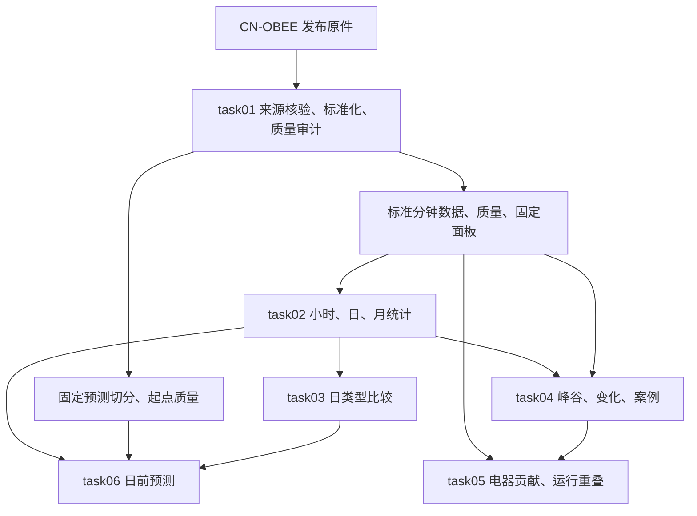

# 家庭用电规律与负荷变化分析

本项目使用 **CN-OBEE v1**，研究北京一户家庭的监测电器用电规律、工作日与休息日差异、峰谷变化、电器贡献及日前负荷预测。

**当前进度（2026-11-13）：task01—task03 已完成并经核验，task02/task03 修订成果已合入仓库；task04—task06 尚待执行。** 仓库包含发布原件、标准分钟数据、质量标记和可复现程序。克隆后即可读取现成数据开展后续任务。

## 所有版本与当前推荐

完整迭代、逐项改动、数值影响和历史归档见 **[CHANGELOG.md](CHANGELOG.md)**。标准数据版本与任务派生版本分别管理；后续任务使用默认 `main` 的当前成果。

| 内容 | 当前推荐 / 历史状态 | 入口 |
| --- | --- | --- |
| task01 数据基础 | `cn_obee_v1_noimpute_v1.0.0`，仍在使用 | [任务说明](task01/README.md) |
| task02 原始版，2026-11-11 | 历史，原版未单独编号 | [原始快照](https://github.com/SUEP-data-analysis-group/household-electricity-analysis/tree/task02-original-20261111) |
| task03 原始版，2026-11-12 | 历史本地交付，缺正式数据；2026-11-13 才归档 | [原始快照](https://github.com/SUEP-data-analysis-group/household-electricity-analysis/tree/task03-original-20261112/task03) |
| task02 当前严格修订版 | `task02_v1.1.0_20261113` | [README](task02/README.md)、[版本记录](task02/CHANGELOG.md)、[8 个正式 CSV 与清单](data/derived/task02/) |
| task03 当前完整修订版 | `task03_v1.1.0_20261113` | [README](task03/README.md)、[版本记录](task03/CHANGELOG.md)、[10 个正式 CSV 与清单](data/derived/task03/) |

旧版通过 Git 历史标签保留，主分支不重复摆放多套旧结果。各任务目录存程序/报告，正式数据集中在 `data/derived/`；task03 另附 [可独立复跑的完整 ZIP](task03/deliverables/task03_工作日与休息日比较_完整成果包.zip)。

## 2026-11-13 修订与后续数据入口

- task02 修订版 `task02_v1.1.0_20261113`：严格 mean_power_kw 在不完整小时为空；有效片段均值另列 observed_duration_mean_power_kw。补齐月度 312 行、季节时期 120 行典型曲线和两张图，并扩充输入/输出哈希与核验。
- task03 修订版 `task03_v1.1.0_20261113`：已生成 10 个正式 CSV 和派生清单，刷新 task02 输入哈希；自然周末与实际休息日主差值仍为约 0.520/0.434 kWh，区间均覆盖 0。
- 352 个完整日合计约 2739.60 kWh，不代表包含 14 个不完整日的完整区间总电量；标准分钟数据、面板和新增插补为 0 的规则保持一致。

| 下一项任务 | 现在可读取的仓库文件 |
| --- | --- |
| task04 峰谷与案例 | [task02 严格小时表](data/derived/task02/hourly_panel13.csv)、[完整日表](data/derived/task02/daily_panel13.csv)和 [task03 日期标签](data/derived/task03/date_dimension.csv) |
| task05 电器贡献 | [task02 设备小时表](data/derived/task02/hourly_appliance.csv)、task01 分钟明细与质量，并使用 task04 的同一案例区间 |
| task06 日前预测 | [task02 连续小时表](data/derived/task02/hourly_panel13.csv)、[task03 全年日历](data/derived/task03/holiday_calendar_2021_2022.csv)和 [task01 固定切分](task01/reports/split_manifest.json) |

当前数据字段、完整性要求、复现命令和交接规则分别见 [task02 README](task02/README.md)及 [task03 README](task03/README.md)。主目标继续使用严格负荷和 hour_complete，不以片段诊断均值补标签；预测只使用当时已公布的日历字段。

## 从这里开始

1. 阅读 [task01 实际质量报告](task01/reports/quality_report.md)，了解数据范围、缺口与可用时段。
2. 查阅 [数据字段与读取约定](task01/DATA_CONTRACT.md)，确认单位、时间、空值和面板字段。
3. 直接读取 [task02 正式数据](data/derived/task02/)和 [task03 正式数据](data/derived/task03/)，按 task04—task06 的 README 继续。

## task01 具体完成了什么

task01 建立六项任务共用的数据基础，回答“数据从哪里来、每列表示什么、哪些值和时段可用、后续必须保持什么口径”。

| 已完成的工作 | 实际处理与成果 |
| --- | --- |
| 核对发布来源 | 核验压缩包和 8 个 CSV 的 SHA-256、压缩包 CRC，保留原件；另存官方 Code v1 的 Notebook.pdf |
| 建立字段字典 | 对照真实表头和官方说明，映射全部源列；确认功率 W、北京时间 Asia/Shanghai，保留环境和行为语义 |
| 核查时间和质量 | 检查解析、重复、冲突、乱序、时间缺行、数值缺测与异常候选，记录来源行号和质量原因 |
| 整理标准数据 | 保留 14 台电器明细、6 个房间数据及小时天气；本次新增插补为 0，有效功率数值未修改，时间缺口保留 |
| 锁定主分析面板 | 以不含电饭煲的固定 13 台设备构成 panel13；14 台共同有效时段另存为 panel14 补充口径 |
| 计算样本支持 | panel13 联合有效率 96.8207%，严格合格小时 8,503 个、完整日 352 天；2021 年 6—7 月缺测集中 |
| 验证聚合规则 | 核对面板求和、分设备积分、分钟到小时到日的能量一致性，39 项管道验收通过 |
| 固定预测日历 | 提前冻结训练、4 周验证和 8 周测试边界，逐日起点检查 168 小时历史及 24 小时目标质量 |

“panel13 总负荷”表示固定 13 台监测设备的合计功率。数据未发布独立整户总表，研究结论须注明监测范围。电饭煲大量缺测，因此保留明细但不加入主面板；不能在不同日期改变主面板设备数量。

## task01 的结果在哪里

标准数据版本：`cn_obee_v1_noimpute_v1.0.0`；面板版本：`v1.0.0`。

| 入口 | 内容及用途 |
| --- | --- |
| [power_minute.csv.gz](data/standardized/cn_obee_v1_noimpute_v1.0.0/power_minute.csv.gz) | 14 台电器分钟功率及来源行号，供积分、电器贡献和运行分析 |
| [panel_minute.csv.gz](data/standardized/cn_obee_v1_noimpute_v1.0.0/panel_minute.csv.gz) | panel13/panel14 分钟负荷、有效设备数和完整性；主分析筛选 panel_id=panel13 |
| [appliance_quality/](data/standardized/cn_obee_v1_noimpute_v1.0.0/appliance_quality/) | 逐设备源值、可用值、缺失/异常标记、是否新增插补 |
| [标准数据目录](data/standardized/cn_obee_v1_noimpute_v1.0.0/) | 同时包含 6 个房间表、小时天气及 auxiliary_quality；辅助缺测不连带删除功率 |
| [data_dictionary.csv](task01/reports/data_dictionary.csv)、[panel_definition.json](task01/reports/panel_definition.json) | 源字段含义、单位、设备映射与固定面板清单 |
| [覆盖汇总](task01/reports/coverage_overall.csv)、[月度覆盖](task01/reports/coverage_monthly.csv)、[缺口报告](task01/reports/gap_report.csv) | 决定分析时段与质量筛选，解释月份和季节的样本支持 |
| [split_manifest.json](task01/reports/split_manifest.json)、[forecast_origin_quality.csv](task01/reports/forecast_origin_quality.csv) | task06 的固定日历边界及候选起点质量 |
| [strict_hourly_check.csv](task01/reports/strict_hourly_check.csv)、[strict_daily_check.csv](task01/reports/strict_daily_check.csv) | task01 的聚合交叉核验结果，供 task02 对照验算 |

大表使用 gzip 压缩的 UTF-8 CSV，`pandas.read_csv()` 可以直接读取，无需先手动解压。原发布数据与下载记录见 [data/raw/](data/raw/README.md)。

## task02—task06 如何利用 task01 继续

后续新结果统一保存到 `data/derived/task02/` 至 `data/derived/task06/`。**task02 和 task03 的正式结果已交付到仓库；task04—task06 的派生结果仍待生成。** 每项任务应记录所用标准版本、面板、时间范围、筛选规则及排除数量。

| 任务 | 读取哪些输入 | 接着完成什么 | 已生成 / 计划输出 |
| --- | --- | --- | --- |
| [task02 时间统计](task02/README.md) | task01 的 power_minute、panel_minute、面板定义和质量信息 | 固定 panel13，按分钟近似积分；发布严格小时/日统计、月度支持和典型曲线；与 task01 核验表对照 | hourly_panel13.csv、daily_panel13.csv、hourly_appliance.csv、monthly_support.csv、典型曲线与图表 |
| [task03 工作日与休息日比较](task03/README.md) | task02 的日表、完整日小时曲线；task01 的质量与日期范围 | 建立 2021—2022 年自然星期与法定节假日/调休两套标签；在同月/季节内比较电量和曲线，报告日数与置信区间 | date_dimension.csv、节假日表、日类型统计、分层差异与样本支持 |
| [task04 峰谷与变化](task04/README.md) | task02 的严格小时表和完整日清单；task01 的标准分钟负荷 | 在 352 个完整日计算小时峰谷、峰谷差和负荷率；保留并列峰；只对真正相邻的有效小时计算变化；确定案例 | daily_peak_valley.csv、峰时分布、hourly_changes.csv、case_manifest.csv |
| [task05 电器贡献与重叠](task05/README.md) | task01 的电器分钟表、逐设备质量和面板定义；task04 的案例；task02 的合格时段 | 使用同一共同有效集合计算 13 台贡献；14 台补充单独重算；逐设备制定运行阈值并统计分钟重叠 | 主/补充贡献表、峰时贡献、运行阈值、分钟运行状态、overlap_summary.csv |
| [task06 日前预测](task06/README.md) | task02 的连续小时表；task01 的固定切分及起点质量；task03 的已知日历标签 | 每日 00:00 预测未来 24h；构造发布时间之前可用的历史特征；比较昨日、上周基线与 LightGBM；在共同样本上评估 | 特征目录、共同评分掩码、predictions.csv、metrics.csv、峰值误差、模型与训练日志 |



### 共同的数据使用规则

1. 主分析固定 `panel13/v1.0.0`，主分钟功率用 `panel_power_w`；`available_sum_w` 是部分设备求和的诊断量，不能拿它替代主负荷。
2. 分钟功率单位 W。规则分钟上用 `sum(P_W)/60000` 近似得到 kWh；只有面板联合有效 60/60 分钟才给出完整小时电量，完整日要求 24/24 合格小时。
3. 文件分析区间为 `[2021-05-31 00:00, 2022-06-01 00:00)`，共 366 个自然日。末端 2022-06-01 00:00 单条保留在标准表，聚合时不算新的一天。
4. 缺测继续留空，保留连续日历和质量标记。不得把缺测补成 0、删除缺测后重新拼接日期，或混用 13 台和 14 台口径。
5. 2021-05 仅有 1 个观测日，2021-06/07 有缺口；这三个月不能直接发布完整月电量。2021-08 至 2022-05 的月度完整支持见质量报告。
6. 标准数据中的上游作者填补身份无法逐点识别，记录为 unknown。环境缺测、PPC 风向记号、运动 0 和窗状态分钟均值均按数据字典解释。

### task06 已固定的边界

| 分段 | 左闭起点（北京时间） | 右开终点（北京时间） | 完整历史与完整 24h 目标的候选起点 |
| --- | --- | --- | --- |
| 训练 | 2021-05-31 00:00 | 2022-03-09 00:00 | 253 / 282 天 |
| 验证 | 2022-03-09 00:00 | 2022-04-06 00:00 | 28 / 28 天 |
| 测试 | 2022-04-06 00:00 | 2022-06-01 00:00 | 56 / 56 天 |

上述候选数尚未经过最终模型特征过滤。每个预测起点使用过去 168h，主目标为未来 24h 小时平均负荷 kW。主版无可追溯发布时间的历史天气预报，因此只用已知日历和历史负荷，不把次日天气实况当成已知预报。最终共同评分掩码在看模型成绩前冻结。

## 快速使用仓库

```bash
git clone https://github.com/SUEP-data-analysis-group/household-electricity-analysis.git
cd household-electricity-analysis
python -m pip install -r task01/requirements.txt
python task01/verify_delivery.py
```

从项目根目录读取现成标准数据：

```python
from pathlib import Path
import pandas as pd

std = Path("data/standardized/cn_obee_v1_noimpute_v1.0.0")
power = pd.read_csv(std / "power_minute.csv.gz", float_precision="round_trip")
panel = pd.read_csv(std / "panel_minute.csv.gz", float_precision="round_trip")
panel = panel.loc[panel["panel_id"].eq("panel13")].copy()
panel["timestamp"] = pd.to_datetime(panel["timestamp"]).dt.tz_convert("Asia/Shanghai")
panel = panel.set_index("timestamp").sort_index()
panel = panel.loc[panel.index < pd.Timestamp("2022-06-01", tz="Asia/Shanghai")]
assert panel.index.is_unique
# 保留缺口，再按 task02 README 的完整性和积分规则生成派生表。
```

需要从原件重新生成 task01 时运行 `python task01/run_task01.py`，运行规则、版本与核验方法见 [task01 README](task01/README.md)。后续任务直接使用当前标准版本即可。

## 目录说明

| 路径 | 用途 |
| --- | --- |
| data/raw/ | 发布原件、下载清单、官方元数据及补充代码指南 |
| data/standardized/ | task01 标准表与质量标记，供后续任务共同读取 |
| task01/reports/ | 实际质量结论、覆盖/缺口/异常、字典、面板、切分、验收和校验清单 |
| task01/*.py、config.json、requirements.txt | task01 的复现、验证、配置和依赖 |
| task02/—task06/ | 各任务的具体实施说明，后续在相应目录添加程序 |
| data/derived/taskXX/（待生成） | 后续任务各自发布的派生数据与规则清单 |

本仓库保留数据来源与作者引用。原 CN-OBEE 数据集许可证为 CC0，见[官方元数据](data/raw/figshare_metadata.json)中的 license 字段；作者补充材料信息另见[补充来源清单](data/raw/support/support_manifest.json)。

## 本次执行结果

标准版本 `cn_obee_v1_noimpute_v1.0.0`；主面板 `panel13/v1.0.0`；时区 `Asia/Shanghai`；功率 W。分析区间为 `[2021-05-31 00:00, 2022-06-01 00:00)`，共 366 个自然日。13 台联合有效率 96.8207%，严格完整小时 8,503 个、完整日 352 天。本次新增插补 0。

- 标准入口：[分钟电器与面板表](data/standardized/cn_obee_v1_noimpute_v1.0.0/)、[逐设备字典](task01/reports/data_dictionary.csv)、[数据读取约定](task01/DATA_CONTRACT.md)。
- 14 台共同有效率 41.2953%，只用于共同有效时段补充。没有独立整户总表。
- 主面板 352 个严格完整日；2021-06、07 缺测集中，不能按完整月报告电量；2021-05 只有 1 个观测日。末端 2022-06-01 00:00 单条保留但不算新的一天。
- 冻结训练 [2021-05-31,2022-03-09)、验证 [2022-03-09,2022-04-06)、测试 [2022-04-06,2022-06-01)，都是北京时间左闭右开区间。
- 运行入口：`python task01/run_task01.py`；验收结果见[质量报告](task01/reports/quality_report.md)，继续步骤见 task02–06 各 README。

## 参考论文和数据链接

1. Wang, C., Li, X., Sun, W., An, J., & Gao, S. (2024). **Occupant behavior, thermal environment, and appliance electricity use of a single-family apartment in China**. *Scientific Data*, 11, 65。
   - [期刊页面和 DOI](https://doi.org/10.1038/s41597-023-02891-9)
   - [可公开阅读全文的 PMC 页面](https://pmc.ncbi.nlm.nih.gov/articles/PMC10784530/)
   - 用途：核对数据含义、采集方式、作者的预处理和已知质量问题，是任务一至五的数据依据。
2. Saleptsis, M., Mussetta, M., & Leva, S. (2025). **Gradient Boosting Algorithms for Day-ahead Residential Load Forecasting of Individual Household**. *2025 International Conference on Clean Electrical Power (ICCEP)*。
   - [米兰理工大学官方论文记录](https://re.public.polimi.it/handle/11311/1304587)
   - 用途：借鉴单户家庭、小时粒度、日前预测及梯度提升树与持续性基线比较的研究思路。用户已确认下载该论文，但本方案尚未依据全文复核详细实验，目前依据公开摘要，不声称复现其详细设置。昨日、上周基线和最后 8 周测试等具体设置来自本作业规划与本方案。
3. **CN-OBEE 数据集**：使用第一篇论文引用的版本作为可复现起点。
   - [Figshare 数据集集合 DOI v1](https://doi.org/10.6084/m9.figshare.c.6742536.v1)
   - [数据文件页面](https://springernature.figshare.com/articles/dataset/The_CN-OBEE_dataset_occupant_behavior_thermal_environment_and_appliance_electricity_use_of_a_single-family_apartment_in_China/23686476)，条目版本 DOI 为 `10.6084/m9.figshare.23686476.v1`。已通过官方元数据给出的下载链接取得发布原件，保存[来源清单](data/raw/source_manifest.json)及[官方元数据](data/raw/figshare_metadata.json)。

## 数据条件与必须先解决的问题

根据 Wang 等的 Methods、Data Records 和 Technical Validation，CN-OBEE 包含北京一户家庭的 14 台电器，发布数据为分钟级电器及房间记录、小时级室外天气。主要用电文件为 `Power.csv`，另有 6 个房间文件及 `Outdoor_weather.csv`。数据已经过作者规则化处理，不能视作未经处理的逐次传感器上报。论文报告电饭煲约 57% 缺测、主卧环境数据约 42% 缺测，部分空调停用期间由作者补零；运动传感器的 0 也不等同于确认无人。[来源与处理说明](https://pmc.ncbi.nlm.nih.gov/articles/PMC10784530/)

这些事实带来三项方案决定：

- 保留 14 台电器原列，但优先核验“不含电饭煲的固定 13 台电器”能否作为跨全年任务的候选主面板。实际联合覆盖已审计为 96.8207%，已锁定 panel13/v1.0.0；2021 年 6—7 月低覆盖的限制仍须单独披露。
- 14 台共同有效的时段单独用于补充分析，明确标注范围和日期。不能把早期 14 台与后期 13 台拼成同一条“总负荷”，也不能补造电饭煲后半段记录。
- 环境和行为作为可选信息单独审计，不能因为主卧温度缺测而删除同一时刻有效的电器功率。

最终主目标名称为“固定监测面板总负荷”，并列明设备。只有确认存在范围独立且完整的家庭总表，才能使用“家庭总负荷”；电器求和不能自动代表整户用电。若坚持全年 14 台完整口径而原数据无法满足，应缩小分析时间或调整数据源，不能靠插补宣称质量达标。

## 三层数据及处理边界

| 层次 | 对应产物 | 允许处理 | 保留要求 |
| --- | --- | --- | --- |
| 发布数据原件 | `data/raw/` | 下载、解压和计算校验值 | 文件字节不修改；这里的 raw 指下载原件，不代表作者采集的原始事件流 |
| 标准数据 | `data/standardized/` | 明确单位、解析时间、去除完全重复、构建时间网格、确认无效值转缺失 | 原值、来源行、质量原因、所有时间缺口和设备列保留；不新增插补 |
| 任务派生数据 | `data/derived/task02/` 至 `task06/` | 依任务进行积分、筛选、特征构造及经论证的插补 | 引用同一标准版本，保存规则、参数、适用日期和派生版本 |

不要用一个不断覆盖的 `clean.csv` 承担所有任务。不得默认执行全表 `dropna`、缺失补零、跨长缺口前向填充、全期均值填补、统一 3σ 删除、平滑高峰或全期标准化。

## 标准数据的最小结构

建议保留便于复核的宽表，同时建立逐设备质量表。Parquet 用于后续计算，CSV 用于分享；若暂时只用 CSV，要把时间格式、空值编码和数值精度写入数据字典。

| 表 | 最小字段 | 说明 |
| --- | --- | --- |
| 电器分钟表 | `timestamp`、固定设备功率列 | 时区 `Asia/Shanghai`；功率单位 W；不把源时间当 UTC 后再次加 8 小时 |
| 电器质量表 | `timestamp, appliance_id, source_file, source_row_id, source_value, usable_value, source_present, is_usable, qc_flags, upstream_fill_status, is_new_imputed` | 作者是否填补不能由 CSV 逐点识别时写 `unknown`；不能把发布值都标成原始实测 |
| 面板分钟表 | `timestamp, panel_id, panel_version, n_expected, n_usable, panel_complete, panel_power_w, available_sum_w` | 主负荷只有在面板设备全部有效时才有值；部分设备求和仅为诊断量 |
| 质量汇总表 | 设备或面板、小时或日期、期望时长、有效时长、覆盖率、最长缺口、排除原因 | 保存原始时间位置；不能删掉缺口后把相隔日期接成相邻记录 |
| 环境与行为表 | 源时间、变量、值、单位、质量、变量含义 | 室外天气保留小时粒度；行为保持事件或状态语义 |
| 数据字典 | 源文件、源列名、标准列名、含义、单位、类型、监测对象、时间语义、作者处理、有效规则 | 正式映射已按真实表头填写，见 task01/reports/data_dictionary.csv |

`source_value` 可为空，也可为被判定无效的原数值；`usable_value` 仅把有充分证据无效的数据变为缺失。一个记录可有多个质量标记，例如源值存在、来源处理未知、数值可疑。可疑尖峰在未确认错误前保持数值，不把统计极端等同于仪表错误。

## 覆盖率和可用性口径

设固定设备集合为 A，在预先声明的分析时间区间内：

- 单设备覆盖率 = 该设备有效时长 / 应有时长。
- 面板联合覆盖率 = A 中所有设备同时有效的时长 / 应有时长。
- 发布值非空率、质量检查后有效率、本次新增插补率分别报告。已发布的作者填补在无法识别时另列“不可逐点识别”，不伪造实测率。
- 95% 是候选分析时段的准入参考，不能以设备覆盖率的均值代替联合覆盖率，也不能在补完以后再算出 100%。

在规则分钟网格上，一个完整小时应有 60 个时间位置，一个完整自然日应有 1440 个。应先核对文件实际首尾、端点是否包含及部分日，不能直接预设总行数。缺失一行与缺失一个设备数值都应影响相应分母和分子。

默认主分析采用严格规则：小时面板联合覆盖为 100% 才给出完整小时电量；完整日期需要 24 个合格小时。其他时段原样保留并标记。95% 至不足 100% 的小时可保存“有效时段累计电量”，不能叫完整小时电量，也不能自动按比例放大。后续如放宽要求，另建敏感性版本并披露数量和影响。

## 各任务的数据基础与状态

| 任务 | 任务一保留的基础 | 当前工作与状态 | 说明文件 |
| --- | --- | --- | --- |
| 一 数据可信度 | 发布原件、分钟数据、全部缺口、来源与质量 | 已完成审计、字典、面板、版本锁定和质量验收 | [任务一 README](task01/README.md) |
| 二 时间统计 | 分钟功率与时间区间 | 已完成严格小时/日/周/月统计、月度及季节典型曲线、样本支持与核验 | [任务二 README](task02/README.md) |
| 三 日类型比较 | 完整日及分钟基础 | 已完成双口径日类型、历史日历、月份分层、日块抽样及正式交付 | [任务三 README](task03/README.md) |
| 四 峰谷变化 | 原始分钟形态及严格小时表 | 完整日峰谷、负荷率、相邻小时变化、并列峰和案例规则 | [任务四 README](task04/README.md) |
| 五 电器解释 | 全部电器列及逐设备质量 | 同时有效样本、固定分母、设备运行阈值、分钟级运行重叠 | [任务五 README](task05/README.md) |
| 六 日前预测 | 连续时间轴、固定面板、缺测标记 | 固定时间切分、发布时间、可用历史窗口、训练期拟合处理、同集评估 | [任务六 README](task06/README.md) |

## 任务一完成时的验收标准

以下为验收口径，task01 已按实际文件执行；逐项结果见[验收表](task01/reports/acceptance_checks.csv)，样本与限制见[质量报告](task01/reports/quality_report.md)：

1. 原件有来源 URL、下载时间、版本、文件大小及 SHA-256；可由处理记录重新生成标准数据。
2. 数据字典覆盖全部源列；功率、累计电量、事件和状态不混淆；总负荷计量范围固定。
3. 标准时间索引唯一、按序、时区明确；每个缺口保留位置和长度；冲突重复有处理依据。
4. 除明确单位转换、完全重复去除和有证据的错误处理外，所有有效数值与来源相符；变动均有记录。
5. 报告设备和面板的年度、月度、日与小时覆盖，不以全期平均掩盖季节缺测；本次新增插补率默认 0。
6. 部分设备缺测时，主面板总负荷为空；所有设备缺测时，诊断求和也必须为空，不能输出 0。
7. 在同一合格区间，分钟积分与小时累计、日电量，以及电器分项与面板电量应在预先规定的数值容差内一致。
8. 候选主面板有足够的连续日历跨度支持训练、4 周验证和 8 周测试，并另有至少 7 天历史上下文；测试期可评分样本数须披露，不能承诺全部日期可用。
9. 六项任务均引用同一发布版本、面板版本、时区与计量单位；差异只存在于有记录的派生规则中。

## 实施顺序与成果

先完成下载清单和字段核对，再做无插补标准化，生成逐设备与联合覆盖报告，比较 13 台候选面板与 14 台补充面板，最后锁定主范围和预测日历边界。随后才开始任务二至六。

任务一已交付：`source_manifest`、`data_dictionary`、`panel_definition`、标准分钟数据及质量标记、`gap_report`、`anomaly_report`、`coverage_hourly`、`coverage_daily`、`quality_report`、`processing_log`、固定规则配置和版本说明。发布原件和原下载清单保留，官方补充 Notebook.pdf 已另存；标准分钟表、逐设备质量、字典、覆盖/缺口/异常报告、面板与切分、可复现程序均已生成。task02、task03 已完成本地修订、正式数据生成与核验；task04—task06 的实施步骤已写明，分析与建模仍待执行。

每个派生版本都应在相应 README 更新实际输入、面板、时间范围、完整性要求、缺口处理、异常处理、样本排除数及原因、参数来源、输出字段、已知限制和与标准版本的关系。不能只保留代码而不说明规则。
