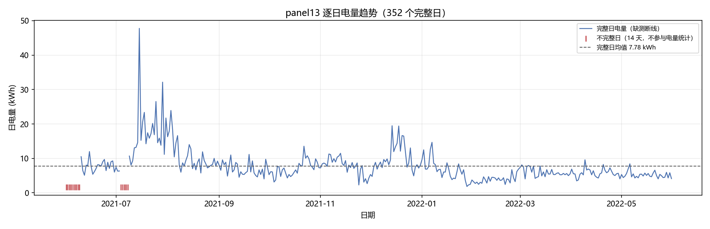
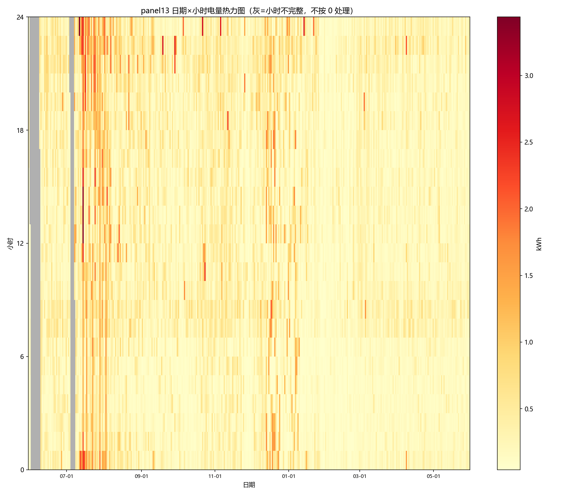
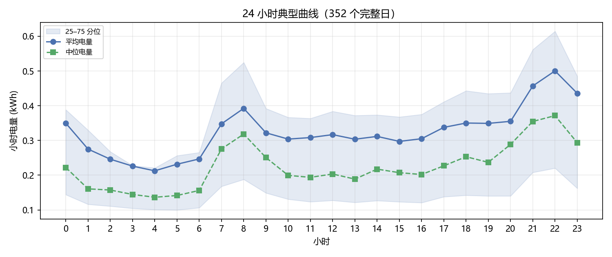
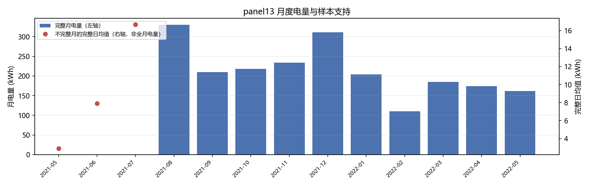
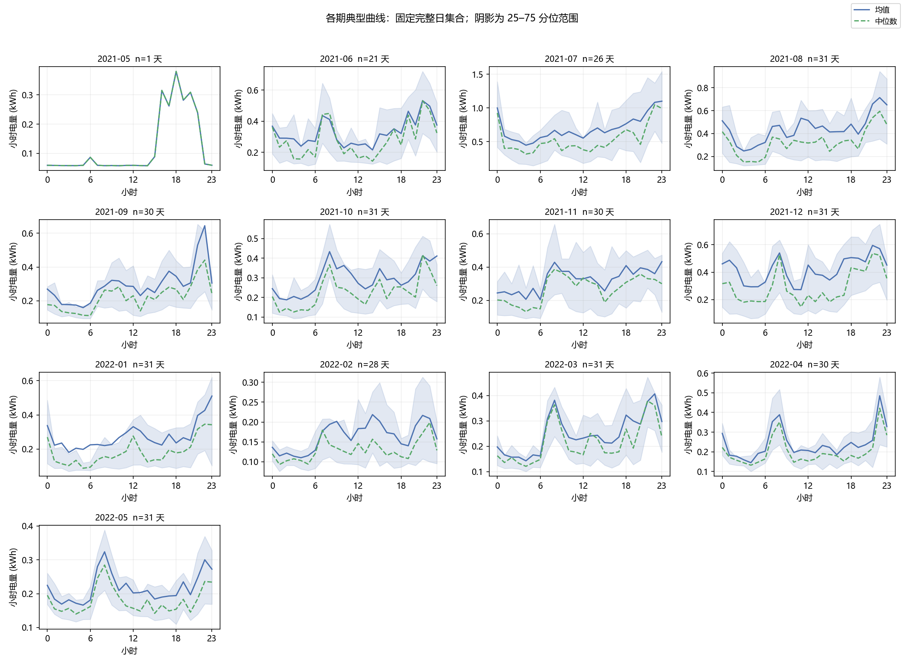
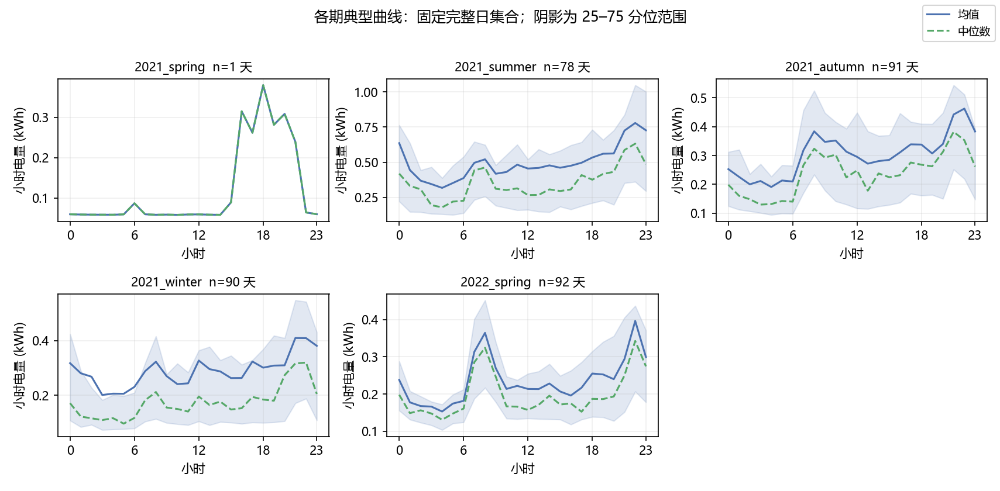

# 任务二 结果报告

数据版本 `cn_obee_v1_noimpute_v1.0.0`；主面板 `panel13/v1.0.0`；时区 `Asia/Shanghai`；功率 W。
分析区间 `[2021-05-31 00:00, 2022-06-01 00:00)`，366 个自然日、8784 个小时。

## 口径

- 计量含义：`panel_power_w` 为已由作者规则化的发布分钟功率，单位 **W**；采用左标签 60 s 矩形近似积分，该分钟电量 `= P_W / 60000` kWh。原发布序列含同分钟上报均值与作者前向保持，不等同于结算电表读数。
- 有效分钟 = `panel_complete` 为真且 `panel_power_w` 非空；缺口不参与积分。
- 小时完整 = 60/60 有效分钟；日完整 = 24/24 完整小时；周完整 = 7/7 完整日。缺口不积分、不延长、不按覆盖率放大。
- `energy_kwh`（kWh）仅在完整时段给出；不完整时段只保留 `valid_duration_energy_kwh` 与覆盖度。
- `mean_power_kw`（kW）仅对完整小时给出，数值等于该完整一小时的 energy_kwh；不完整小时为空。
- `observed_duration_mean_power_kw` 仅表示有效分钟片段的均值，保留 4 个部分小时的诊断信息，不作为完整小时真实目标。日平均负荷为完整日电量 / 24h。

## 结果

- 完整小时 **8503** 个（任务一核验表 8503 个）
- 完整日 **352** 天（任务一核验表 352 天）
- 完整日合计电量 **2739.60 kWh**，日均 **7.78 kWh**，中位 **6.77 kWh**
- 最高完整日 2021-07-15 47.78 kWh；最低完整日 2022-01-28 1.84 kWh
- 24 小时典型曲线：最高小时 **22 时**（均值 0.500 kWh），最低小时 **4 时**（均值 0.213 kWh）
- 日均负荷（`mean_power_kw`）：完整日均值 **0.3243 kW**，最大 **1.9907 kW**；352 个完整日的电量合计为 2739.60 kWh；未包含 14 个不完整日的完整电量，因此不报告全分析期间总电量。电量与负荷分别为能量和功率。

## 各月样本支持

| 月份 | 日历天 | 完整日 | 覆盖度 | 是否完整月 | 完整月电量 kWh | 完整日均值 kWh |
| --- | --- | --- | --- | --- | --- | --- |
| 2021-05 | 1 | 1 | 100.00% | 否 |  | 2.91 |
| 2021-06 | 30 | 21 | 72.98% | 否 |  | 7.89 |
| 2021-07 | 31 | 26 | 88.62% | 否 |  | 16.67 |
| 2021-08 | 31 | 31 | 100.00% | 是 | 330.04 | 10.65 |
| 2021-09 | 30 | 30 | 100.00% | 是 | 210.17 | 7.01 |
| 2021-10 | 31 | 31 | 100.00% | 是 | 218.20 | 7.04 |
| 2021-11 | 30 | 30 | 100.00% | 是 | 233.65 | 7.79 |
| 2021-12 | 31 | 31 | 100.00% | 是 | 311.28 | 10.04 |
| 2022-01 | 31 | 31 | 100.00% | 是 | 203.83 | 6.58 |
| 2022-02 | 28 | 28 | 100.00% | 是 | 110.16 | 3.93 |
| 2022-03 | 31 | 31 | 100.00% | 是 | 184.75 | 5.96 |
| 2022-04 | 30 | 30 | 100.00% | 是 | 173.89 | 5.80 |
| 2022-05 | 31 | 31 | 100.00% | 是 | 161.54 | 5.21 |

## 各周样本支持

- 完整周 **48** 个（7/7 完整日），不完整周 **5** 个；完整周电量合计 **2624.3 kWh**，周均 54.7 kWh，最高 147.8 kWh、最低 21.0 kWh

| 周起始（周一） | 周结束 | ISO 周 | 完整日/日历天 | 周电量 kWh | 完整日均值 kWh | 是否完整周 |
| --- | --- | --- | --- | --- | --- | --- |
| 2021-05-31 | 2021-06-06 | 2021-W22 | 1/7 |  | 2.91 | 否 |
| 2021-06-07 | 2021-06-13 | 2021-W23 | 4/7 |  | 7.52 | 否 |
| 2021-06-14 | 2021-06-20 | 2021-W24 | 7/7 | 54.46 | 7.78 | 是 |
| 2021-06-21 | 2021-06-27 | 2021-W25 | 7/7 | 56.89 | 8.13 | 是 |
| 2021-06-28 | 2021-07-04 | 2021-W26 | 6/7 |  | 7.40 | 否 |
| 2021-07-05 | 2021-07-11 | 2021-W27 | 3/7 |  | 9.35 | 否 |
| 2021-07-12 | 2021-07-18 | 2021-W28 | 7/7 | 147.82 | 21.12 | 是 |
| 2021-07-19 | 2021-07-25 | 2021-W29 | 7/7 | 128.22 | 18.32 | 是 |
| 2021-07-26 | 2021-08-01 | 2021-W30 | 7/7 | 125.59 | 17.94 | 是 |
| 2021-08-02 | 2021-08-08 | 2021-W31 | 7/7 | 109.93 | 15.70 | 是 |
| 2021-08-09 | 2021-08-15 | 2021-W32 | 7/7 | 69.47 | 9.92 | 是 |
| 2021-08-16 | 2021-08-22 | 2021-W33 | 7/7 | 58.59 | 8.37 | 是 |
| 2021-08-23 | 2021-08-29 | 2021-W34 | 7/7 | 58.77 | 8.40 | 是 |
| 2021-08-30 | 2021-09-05 | 2021-W35 | 7/7 | 58.13 | 8.30 | 是 |
| 2021-09-06 | 2021-09-12 | 2021-W36 | 7/7 | 53.50 | 7.64 | 是 |
| 2021-09-13 | 2021-09-19 | 2021-W37 | 7/7 | 44.57 | 6.37 | 是 |
| 2021-09-20 | 2021-09-26 | 2021-W38 | 7/7 | 42.73 | 6.10 | 是 |
| 2021-09-27 | 2021-10-03 | 2021-W39 | 7/7 | 45.67 | 6.52 | 是 |
| 2021-10-04 | 2021-10-10 | 2021-W40 | 7/7 | 40.63 | 5.80 | 是 |
| 2021-10-11 | 2021-10-17 | 2021-W41 | 7/7 | 37.78 | 5.40 | 是 |
| 2021-10-18 | 2021-10-24 | 2021-W42 | 7/7 | 64.29 | 9.18 | 是 |
| 2021-10-25 | 2021-10-31 | 2021-W43 | 7/7 | 58.06 | 8.29 | 是 |
| 2021-11-01 | 2021-11-07 | 2021-W44 | 7/7 | 62.72 | 8.96 | 是 |
| 2021-11-08 | 2021-11-14 | 2021-W45 | 7/7 | 68.75 | 9.82 | 是 |
| 2021-11-15 | 2021-11-21 | 2021-W46 | 7/7 | 54.57 | 7.80 | 是 |
| 2021-11-22 | 2021-11-28 | 2021-W47 | 7/7 | 40.69 | 5.81 | 是 |
| 2021-11-29 | 2021-12-05 | 2021-W48 | 7/7 | 40.30 | 5.76 | 是 |
| 2021-12-06 | 2021-12-12 | 2021-W49 | 7/7 | 60.95 | 8.71 | 是 |
| 2021-12-13 | 2021-12-19 | 2021-W50 | 7/7 | 100.21 | 14.32 | 是 |
| 2021-12-20 | 2021-12-26 | 2021-W51 | 7/7 | 80.92 | 11.56 | 是 |
| 2021-12-27 | 2022-01-02 | 2021-W52 | 7/7 | 57.98 | 8.28 | 是 |
| 2022-01-03 | 2022-01-09 | 2022-W01 | 7/7 | 65.47 | 9.35 | 是 |
| 2022-01-10 | 2022-01-16 | 2022-W02 | 7/7 | 44.91 | 6.42 | 是 |
| 2022-01-17 | 2022-01-23 | 2022-W03 | 7/7 | 38.55 | 5.51 | 是 |
| 2022-01-24 | 2022-01-30 | 2022-W04 | 7/7 | 29.02 | 4.15 | 是 |
| 2022-01-31 | 2022-02-06 | 2022-W05 | 7/7 | 21.04 | 3.01 | 是 |
| 2022-02-07 | 2022-02-13 | 2022-W06 | 7/7 | 28.34 | 4.05 | 是 |
| 2022-02-14 | 2022-02-20 | 2022-W07 | 7/7 | 26.34 | 3.76 | 是 |
| 2022-02-21 | 2022-02-27 | 2022-W08 | 7/7 | 31.30 | 4.47 | 是 |
| 2022-02-28 | 2022-03-06 | 2022-W09 | 7/7 | 49.44 | 7.06 | 是 |
| 2022-03-07 | 2022-03-13 | 2022-W10 | 7/7 | 42.59 | 6.08 | 是 |
| 2022-03-14 | 2022-03-20 | 2022-W11 | 7/7 | 40.07 | 5.72 | 是 |
| 2022-03-21 | 2022-03-27 | 2022-W12 | 7/7 | 38.19 | 5.46 | 是 |
| 2022-03-28 | 2022-04-03 | 2022-W13 | 7/7 | 39.21 | 5.60 | 是 |
| 2022-04-04 | 2022-04-10 | 2022-W14 | 7/7 | 39.87 | 5.70 | 是 |
| 2022-04-11 | 2022-04-17 | 2022-W15 | 7/7 | 38.96 | 5.57 | 是 |
| 2022-04-18 | 2022-04-24 | 2022-W16 | 7/7 | 45.32 | 6.47 | 是 |
| 2022-04-25 | 2022-05-01 | 2022-W17 | 7/7 | 37.14 | 5.31 | 是 |
| 2022-05-02 | 2022-05-08 | 2022-W18 | 7/7 | 40.39 | 5.77 | 是 |
| 2022-05-09 | 2022-05-15 | 2022-W19 | 7/7 | 34.85 | 4.98 | 是 |
| 2022-05-16 | 2022-05-22 | 2022-W20 | 7/7 | 37.48 | 5.35 | 是 |
| 2022-05-23 | 2022-05-29 | 2022-W21 | 7/7 | 33.57 | 4.80 | 是 |
| 2022-05-30 | 2022-05-31 | 2022-W22 | 2/2 |  | 4.97 | 否 |

## 形态与季节归纳

- **典型日内形态**：主峰在 **22 时**（0.500 kWh），次峰在 **8 时**（0.392 kWh），白天 10–19 时基本平稳（0.30–0.35 kWh），谷值在 **4 时**（0.213 kWh）。夜间 21–23 时明显抬升（0.457 / 0.500 / 0.436 kWh），这些是监测面板的时段形态；具体设备贡献和住户起床时间需另用分项或行为证据验证。
- **季节变化**：只比较 10 个完整月。最高 **2021-08**（10.65 kWh/天），最低 **2022-02**（3.93 kWh/天）。8 月（10.65）与 12 月（10.04）构成夏、冬两个高平台，3–5 月（5.96 / 5.80 / 5.21）处于中间水平，观测期完整日样本均值 7.78 kWh/天；各月负荷水平存在差异，具体设备和季节机制留待任务五分项验证。（2021-07 只有 26 个完整日，样本均值 16.67 kWh/天，样本不足以代表整月，不与完整月并列比较。）
- **主峰时刻**：各完整月逐时均值最大值的落点为 2021 年 8 月 22 时、2021 年 9 月 22 时、2021 年 10 月 8 时、2021 年 11 月 23 时、2021 年 12 月 21 时、2022 年 1 月 23 时、2022 年 2 月 14 时、2022 年 3 月 22 时、2022 年 4 月 22 时、2022 年 5 月 8 时。其中 2 个月（10、5 月）最高点在早晨 8 时，7 个月（8、9、11、12、1、3、4 月）最高点在晚间 21–23 时，耗电最低的 2022 年 2 月曲线最平坦、最高点落在午后。典型曲线上早晨与晚间负荷的相对高度随月份变化；仅凭面板曲线不能判断住户作息是否整体位移。
- **从图里读出、需要进一步比较的变化**：
  1. 日电量在同一季节内部仍有明显高低起伏（热力图与趋势图上多段连续深色带），工作日与周末是否构成两套不同的用电方式，留给任务三检验；
  2. 夏、冬两个高平台的形成原因需要分项证据，`data/derived/task02/hourly_appliance.csv` 已按 13 台设备逐小时备好；
  3. 各月峰值高度差异明显（7 月中旬单周 147.8 kWh、2 月初单周 21.0 kWh），且最高点在早晨 8 时与晚间 21–23 时之间切换，说明「峰值变高」更像某一类负荷被放大而非作息整体后移，可在峰谷分析时用分项表确认是空调还是热水器驱动；
  4. 2022-02 的低谷是否与假期外出有关，仅凭功率数据无法判定，需要外部作息信息。

## 按月与季节的典型曲线

- monthly_typical_hourly_profile.csv 共 312 行，13 个年月份各 24 小时。
- seasonal_typical_hourly_profile.csv 共 120 行，5 个季节时期各 24 小时。
- 每期均值、中位数、25/75 分位数、最小/最大值和 n_days 使用同一批完整日。
- 2021-05 只有 1 个完整日；2021 年夏季仅有 78 个完整日。两端春季分开；冬季以十二月所在年命名。分组曲线是样本描述，不补足缺测月份。

| 时期 | 完整日样本数 |
| --- | --- |
| 2021-05 | 1 |
| 2021-06 | 21 |
| 2021-07 | 26 |
| 2021-08 | 31 |
| 2021-09 | 30 |
| 2021-10 | 31 |
| 2021-11 | 30 |
| 2021-12 | 31 |
| 2022-01 | 31 |
| 2022-02 | 28 |
| 2022-03 | 31 |
| 2022-04 | 30 |
| 2022-05 | 31 |
| 2021_spring | 1 |
| 2021_summer | 78 |
| 2021_autumn | 91 |
| 2021_winter | 90 |
| 2022_spring | 92 |

## 剔除与标记

- 不完整日 14 天：2021-06-01, 2021-06-02, 2021-06-03, 2021-06-04, 2021-06-05, 2021-06-06, 2021-06-07, 2021-06-08, 2021-06-09, 2021-07-04, 2021-07-05, 2021-07-06, 2021-07-07, 2021-07-08
- 这些日期保留在时间轴上，`day_complete=False`，电量留空，不当作低用电日，也不写 0。
- 本次未启用短缺口估计版，新增插补 0。

## 核验

```json
{
  "hour_complete_mine": 8503,
  "hour_complete_task01": 8503,
  "usable_minutes_match": true,
  "day_complete_mine": 352,
  "day_complete_task01": 352,
  "hour_energy_max_abs_diff": 4.440892098500626e-16,
  "hour_energy_compared": 8503,
  "hour_index_matches": true,
  "day_index_matches": true,
  "strict_mean_missing_on_incomplete_hours": true,
  "strict_mean_matches_task01": true,
  "hour_energy_nan_mask_matches": true,
  "day_energy_nan_mask_matches": true,
  "all_pass": true
}
```

## 图







