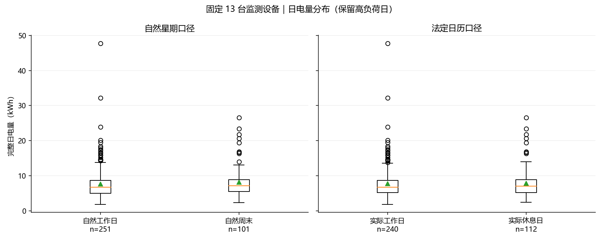
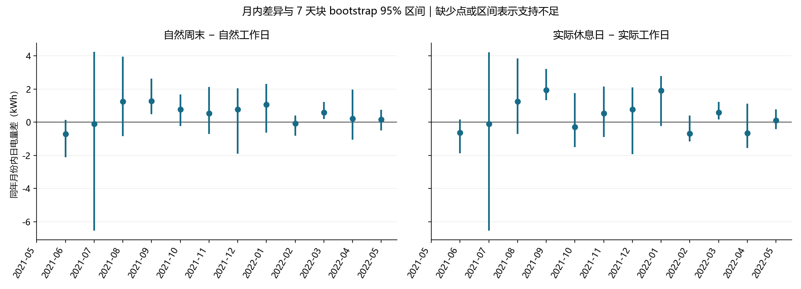
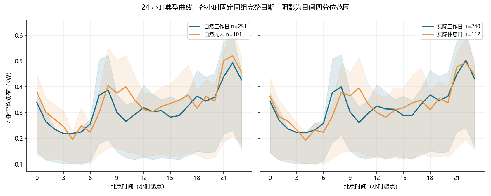
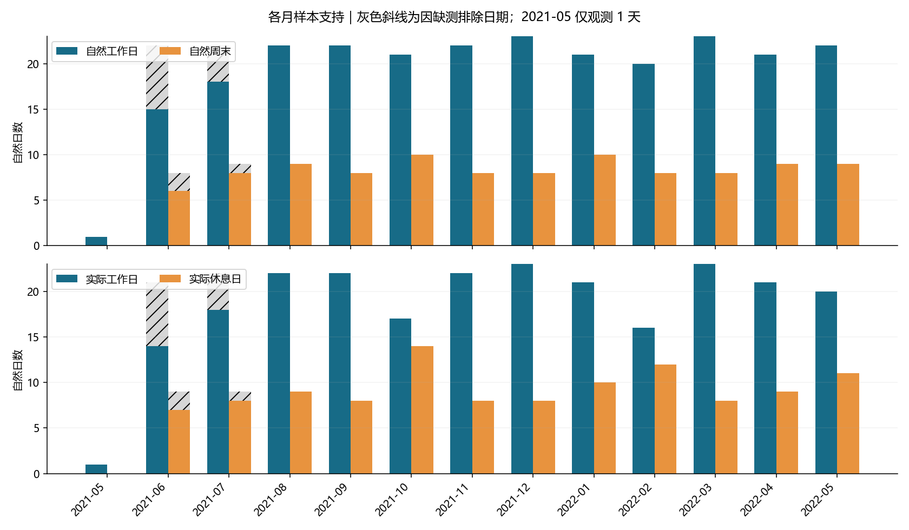
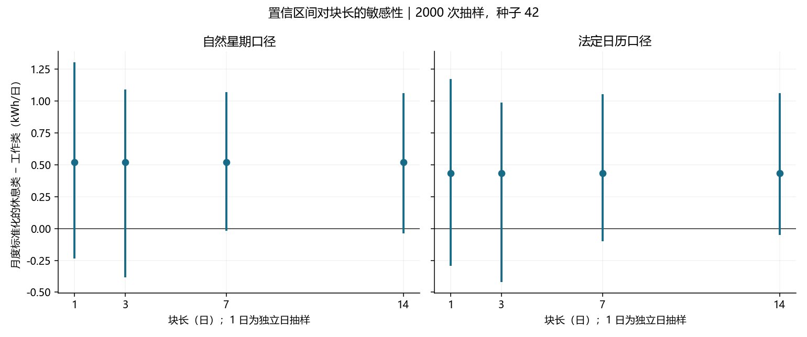
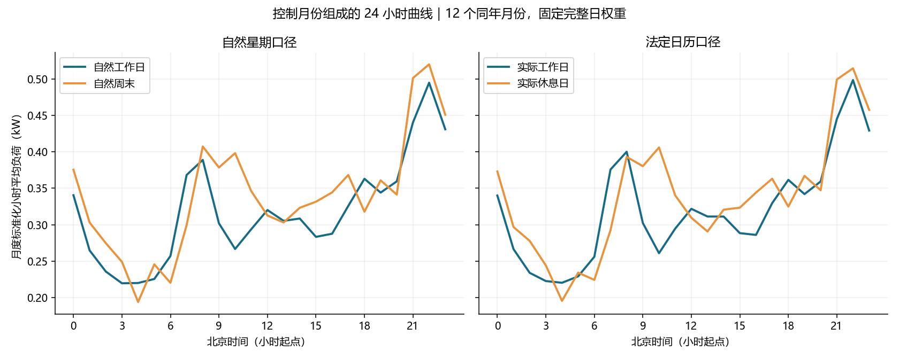

# 任务三：工作日与休息日用电比较

## 主要结果

自然周末相对自然工作日：同月标准化后差 0.520 kWh/日（+6.80%），7 天块 95% 区间 [-0.019, 1.069]。区间覆盖 0，差异方向存在不确定性。
实际休息日相对实际工作日：同月标准化后差 0.434 kWh/日（+5.64%），7 天块 95% 区间 [-0.101, 1.052]。区间覆盖 0，差异方向存在不确定性。

固定 panel13 的 13 台监测设备，不等同于独立整户总表。完整日 352/366；因质量排除 14 日，保留在日历轴中。两套分类在观测区间内有 27 日不同。

| scheme | scope | n_work | n_rest | work_mean_kwh | rest_mean_kwh | difference_kwh | relative_difference_pct | ci_low_kwh | ci_high_kwh |
| --- | --- | --- | --- | --- | --- | --- | --- | --- | --- |
| natural | all_unadjusted | 251 | 101 | 7.621 | 8.186 | 0.565 | 7.413 | 0.045 | 1.228 |
| natural | month_standardized | 250 | 101 | 7.648 | 8.168 | 0.520 | 6.802 | -0.019 | 1.069 |
| actual | all_unadjusted | 240 | 112 | 7.744 | 7.867 | 0.124 | 1.596 | -0.298 | 1.097 |
| actual | month_standardized | 239 | 112 | 7.688 | 8.121 | 0.434 | 5.639 | -0.101 | 1.052 |

差值均为休息类减工作类；相对差以工作类均值为分母。all_unadjusted 是全样本描述；month_standardized 是主要控制月份组成的比较。

## 数据、历史日历与质量

输入为同伴 task02 的正式日表、小时表和派生清单，逐字复制到 data/derived/task02；不重新清洗标准分钟表。分析区间 [2021-05-31, 2022-06-01)，北京时间。数据版本 cn_obee_v1_noimpute_v1.0.0，panel13/v1.0.0；零新增插补。

严格日要求 24/24 合格小时，每小时要求 60/60 联合有效分钟。读取时核验逐小时汇总与日电量相等；与仓库 task01 日核验表复核。未剔除高负荷日，未将缺失当 0。

日历先生成完整 2021、2022 年 730 日再截取。自然星期：周一至周五 weekday，周末 weekend；法定日历：国务院假期区间覆盖自然工作日、调休上班日覆盖自然周末。holiday_name 表示官方放假区间名称（并非区间每一天都是法定节日本日）；它不能证明该住户实际休假或在家。weekday 取 Monday=0。

官方来源（原文 HTML、获取时间和 SHA-256 保存在 sources/）：

- [2021 年安排](https://app.www.gov.cn/govdata/gov/202011/26/465359/article.html)，通知 2020-11-25。
- [2022 年安排](https://app.www.gov.cn/govdata/gov/202110/25/477434/article.html)，通知 2021-10-25。

## 两类日样本及电量

| scheme | day_type | n_days | excluded_days | mean_energy_kwh | median_energy_kwh |
| --- | --- | --- | --- | --- | --- |
| natural | weekday | 251 | 11 | 7.621 | 6.688 |
| natural | weekend | 101 | 3 | 8.186 | 7.098 |
| actual | actual_workday | 240 | 11 | 7.744 | 6.712 |
| actual | actual_restday | 112 | 3 | 7.867 | 6.989 |

### 每月完整日数

| year_month | natural/weekday | natural/weekend | actual/actual_workday | actual/actual_restday |
| --- | --- | --- | --- | --- |
| 2021-05 | 1 | 0 | 1 | 0 |
| 2021-06 | 15 | 6 | 14 | 7 |
| 2021-07 | 18 | 8 | 18 | 8 |
| 2021-08 | 22 | 9 | 22 | 9 |
| 2021-09 | 22 | 8 | 22 | 8 |
| 2021-10 | 21 | 10 | 17 | 14 |
| 2021-11 | 22 | 8 | 22 | 8 |
| 2021-12 | 23 | 8 | 23 | 8 |
| 2022-01 | 21 | 10 | 21 | 10 |
| 2022-02 | 20 | 8 | 16 | 12 |
| 2022-03 | 23 | 8 | 23 | 8 |
| 2022-04 | 21 | 9 | 21 | 9 |
| 2022-05 | 22 | 9 | 20 | 11 |

2021-05 仅 1 个观测日且没有休息类，不能计算月内差异；2021-06/07 缺测集中。排除数、排除率及月份组成见 day_type_support.csv、day_type_summary.csv，逐日排除原因见 date_dimension.csv。缺测集中可能造成选择偏差，严格筛选不能消除该偏差。

## 同月控制与季节

基本层为 year_month，绝不把不同年份相同月份合并。只选同时有工作类、休息类完整日的月份；两类均值分别按该月完整日总数 / 所有可比月份完整日总数加权，再相减。固定权重写入 stratified_comparison.csv；2021-05 的 1 日不参与，主标准化比较为其余 351 日。此估计对象是观测支持月份的共同月份组成，不能解释为全年总体平均效果。

气象季节：3–5 春、6–8 夏、9–11 秋、12–2 冬；季节描述使用 season_period，将 2021 年 5 月边界春季与 2022 年 3–5 月春季分开，2021-12 至 2022-02 合并为 2021_winter。季节结果仍可能有月份组成差异，以同年月份标准化为主。

| scheme | stratum | n_work | n_rest | difference_kwh | ci_low_kwh | ci_high_kwh | status |
| --- | --- | --- | --- | --- | --- | --- | --- |
| natural | 2021_autumn | 65 | 26 | 0.833 | 0.389 | 1.738 | ok |
| natural | 2021_spring | 1 | 0 | — | — | — | missing_day_type |
| natural | 2021_summer | 55 | 23 | 0.422 | -1.759 | 2.380 | ok |
| natural | 2021_winter | 64 | 26 | 0.439 | -0.591 | 1.284 | ok |
| natural | 2022_spring | 66 | 26 | 0.296 | -0.144 | 1.015 | ok |
| actual | 2021_autumn | 61 | 30 | 0.535 | 0.056 | 1.815 | ok |
| actual | 2021_spring | 1 | 0 | — | — | — | missing_day_type |
| actual | 2021_summer | 54 | 24 | 0.175 | -2.014 | 2.156 | ok |
| actual | 2021_winter | 60 | 30 | -0.115 | -1.395 | 1.263 | ok |
| actual | 2022_spring | 64 | 28 | -0.058 | -0.318 | 0.717 | ok |

## 抽样、相关性与置信区间

预设种子 42、2000 次；主块长 7 天对应完整周节律，并列审查 1、3、14 天。先在每个年月份的完整日历（包括缺测日期）抽取非循环移动块，块在原日历中连续、不跨月，拼接后截至原月日数。仅完整日数值参与均值；缺测日期不压缩、不插补。抽样单位最小为日，绝不把分钟视为独立样本。1 日抽样为月份内独立日 bootstrap。

每次重新计算两类均值、差值和相对差，标准化权重固定。95% 百分位区间；两类都存在的抽样不足 95% 时不发布区间，保留有效次数和状态。边界月份块长取 min(L, n)，移动块有端点采样权重不均的问题；短月、少数类别、小样本或长记忆均限制区间校准，块长敏感性不能证明覆盖率。主块长预先锁定，不按是否显著选择。

实际诊断中，原日电量 lag-1 相关约 0.635，按年月份去均值后仍约 0.295，lag-7 约 0.087；支持采用日块并检查不同块长。两套月度标准化估计在 1、3、7、14 天下的区间均覆盖 0；全样本自然星期差的区间会随块长改变是否跨 0，不能把某个区间当作稳定显著结论。

日期轴上的相关性诊断（shift 不会跨缺口压缩）：

| series | lag_calendar_days | n_pairs | pearson_correlation |
| --- | --- | --- | --- |
| raw | 1 | 349 | 0.635 |
| raw | 2 | 347 | 0.647 |
| raw | 3 | 345 | 0.637 |
| raw | 7 | 339 | 0.578 |
| raw | 14 | 333 | 0.431 |
| within_year_month_demeaned | 1 | 349 | 0.295 |
| within_year_month_demeaned | 2 | 347 | 0.261 |
| within_year_month_demeaned | 3 | 345 | 0.218 |
| within_year_month_demeaned | 7 | 339 | 0.087 |
| within_year_month_demeaned | 14 | 333 | 0.002 |

| scheme | scope | block_days | ci_low_kwh | ci_high_kwh | valid_bootstrap_repetitions |
| --- | --- | --- | --- | --- | --- |
| natural | month_standardized | 1 | -0.235 | 1.305 | 1997 |
| natural | month_standardized | 3 | -0.384 | 1.093 | 1987 |
| natural | month_standardized | 7 | -0.019 | 1.069 | 2000 |
| natural | month_standardized | 14 | -0.037 | 1.063 | 2000 |
| actual | month_standardized | 1 | -0.291 | 1.175 | 1998 |
| actual | month_standardized | 3 | -0.418 | 0.989 | 1998 |
| actual | month_standardized | 7 | -0.101 | 1.052 | 1998 |
| actual | month_standardized | 14 | -0.049 | 1.063 | 2000 |

月、季节与小时比较均为探索性，未做大量显著性检验，不发布逐小时显著结论；表中 95% 区间为逐项区间，不是同时置信带。只有一户约一年数据，天气、季节、行为、缺测、节假日出行等均可能混杂，不能解释为休息日的因果作用或推广到其他家庭。

## 24 小时形态

两套口径的每条曲线都使用该组同一批完整日，24 个小时样本数固定。原始曲线为未控制月份的描述，阴影是日电量对应小时负荷的 25%–75% 分位范围，不是均值置信区间。另交付 monthly_hourly_day_type_profile.csv 的月内曲线与 standardized_hourly_day_type_profile.csv 的共同月份权重曲线；后者沿用日电量比较的同一组日期与固定月份权重，24 小时差值积分等于标准化日电量差。小时曲线均为探索性，未进行平滑、削峰或逐小时显著检验。

- 自然工作日：平均曲线峰小时 22:00（0.492 kW），谷小时 03:00（0.218 kW）。
- 自然周末：平均曲线峰小时 22:00（0.520 kW），谷小时 04:00（0.196 kW）。
- 实际工作日：平均曲线峰小时 22:00（0.503 kW），谷小时 04:00（0.222 kW）。
- 实际休息日：平均曲线峰小时 22:00（0.494 kW），谷小时 04:00（0.193 kW）。

## 图表

## 复现与下游交接

在项目根目录运行 `python -m pip install -r task03/requirements.txt`，随后 `python task03/run_task03.py`、`python task03/verify_task03.py`。无需联网，节假日来源已归档。

date_dimension.csv 可供 task04 选择日类型案例；task06 只使用 date、星期、已发布法定假期及调休等事先已知日历字段。不得把 day_complete、energy_kwh、coverage 或当日质量/实测结果作为日前已知特征。通知发布时间写入 notice_date，预测时仍须按发布时间核验。
