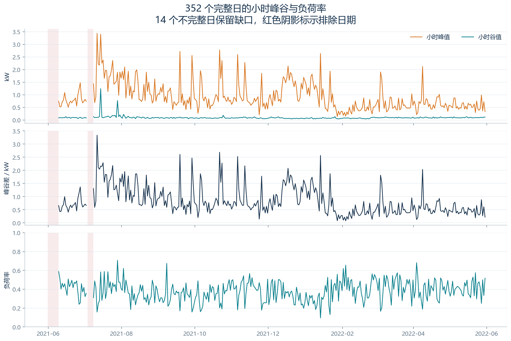
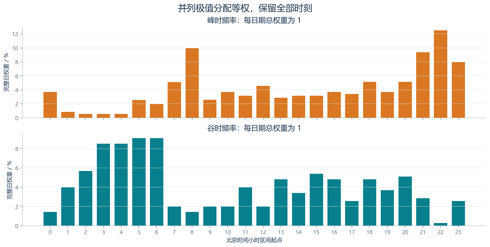
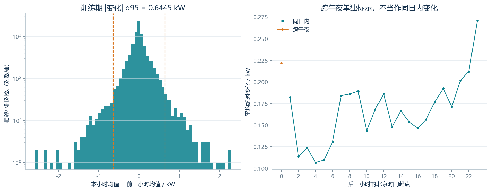
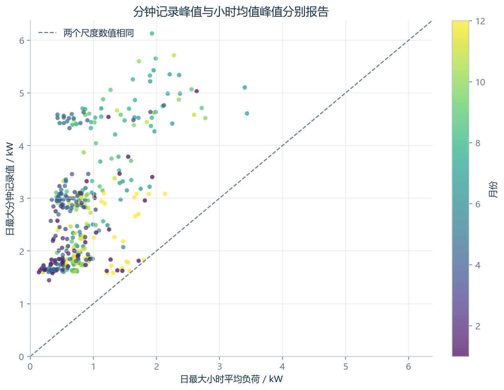
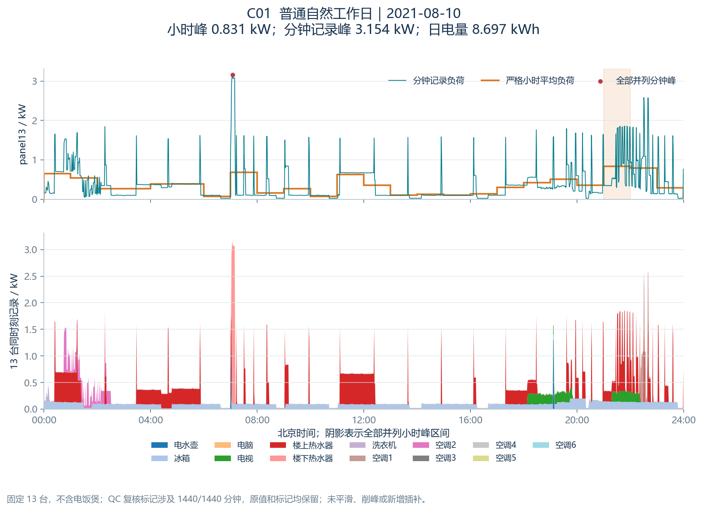
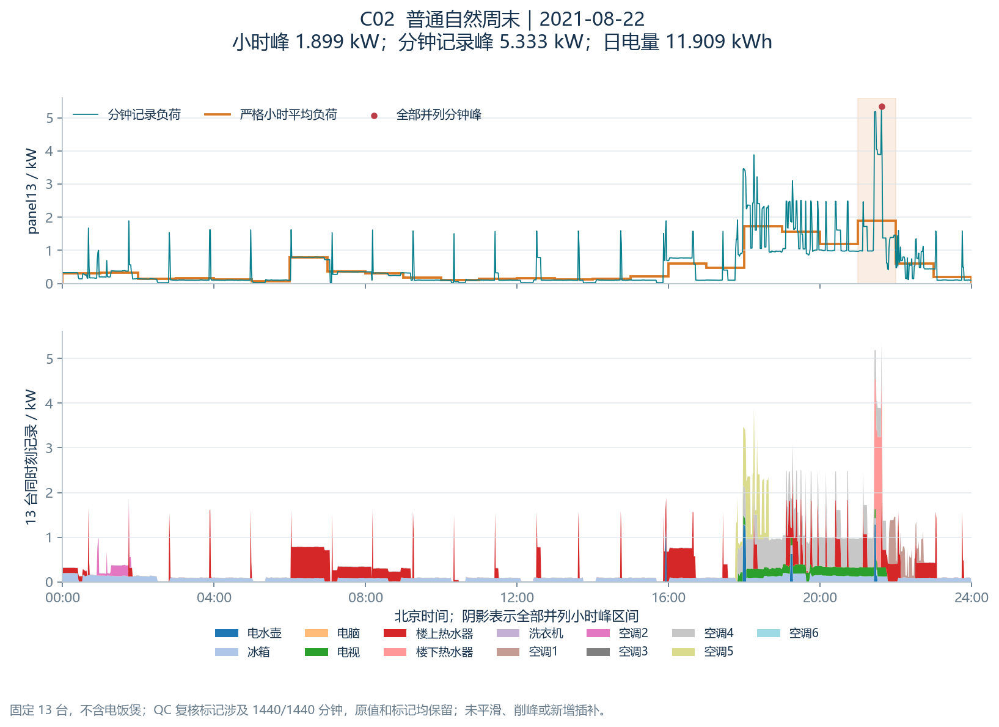
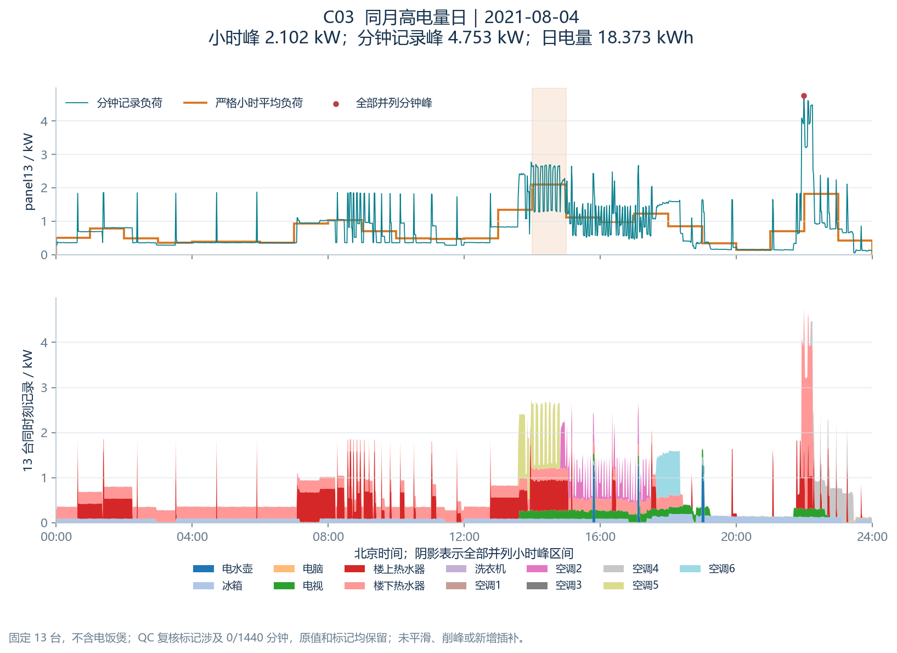
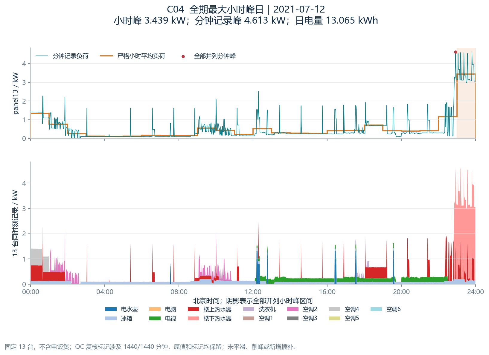

# 任务四：峰谷与日内变化分析报告

派生版本 `task04_v1.0.0_20261114`，完成日期 2026-11-14。来源为仓库提交 `3e0ffa3da8fbacf714bacff1d84094ed08a31f73`；输入与 GitHub 文件逐字节核对，固定 `panel13/v1.0.0`、标准版本 `cn_obee_v1_noimpute_v1.0.0`、北京时间。

## 结论与范围

主日分析使用 352 个完整日，14 个不完整日只保留质量记录。小时峰指 60 个联合有效分钟的平均负荷，分钟峰指规则化发布数据的最大分钟记录；这两者不能混作同一个量。监测范围为固定 13 台电器，不能称作独立整户总表。

| 指标 | 结果 |
| --- | --- |
| 完整日 / 排除日 | 352 / 14 |
| 严格小时 | 8503 |
| 有效相邻变化对 | 8500 |
| 同日内 / 跨午夜 | 8147 / 353 |
| 峰值 / 谷值并列日期 | 1 / 0 |
| 最大小时均值峰 | 3.438890 kW，2021-07-12 |
| 最大分钟记录峰 | 6130.41 W，2021-08-07 |
| 完整日日峰中位数 | 0.760719 kW |
| 完整日负荷率中位数 | 0.379850 |
| 分钟峰 / 小时峰中位比 | 3.3361 |
| 峰时 / 谷时最高频小时 | [22] / [5, 6] |

小时均值会弱化短时峰值，需同时查看分钟记录。上述峰谷时刻是样本内频率描述，不能直接解释住户作息、设备启动或证明某设备造成高峰；具体贡献和运行重叠由任务五在相同时间集合继续核实。

这里的“最高频峰/谷时刻”统计逐日极值出现的位置，与任务二“先求全样本平均曲线、再找曲线峰谷”属于不同指标。353 对跨午夜变化以两个小时均有效为准，可涉及不完整日中的有效小时，分母不是完整日数减一。

## 计算口径

- 区间 `[2021-05-31 00:00,2022-06-01 00:00)`；末端单条不进入分析。日均值、峰、谷、峰谷差和负荷率仅在 24/24 严格小时的日期计算。
- 负荷率 = 日均负荷 / 日峰负荷；峰为 0 时不可定义，留空。CSV 保留 float64 精度；报告表格只为显示而舍入。
- 并列以 round-trip 读回的 float64 完全相等判定，每日每种极值的全部时刻各分配 `1/tied_count`。频率分母是完整日数。
- 变化在连续小时索引上计算，只有两个小时均严格有效且确实相隔 1h 才相减。可包含不完整日中本身有效的小时；跨午夜单列，缺口两侧不比较。
- “大变化”定义为 `abs_delta_kw > 0.644477241667 kW`；阈值是训练期 `[2021-05-31T00:00:00+08:00, 2022-03-09T00:00:00+08:00)` 内 6484 个有效变化对的 q95（linear）。主模型用途不能改用全期 q95。
- 另存训练期 6487 个严格小时的负荷 q90 = 0.732609766667 kW，供任务六评估高负荷小时候选规则使用；不代表已完成预测或评分。
- 不插补、不平滑、不缩尾。源设备 QC 位原样附带，近量程与长常值复核标记不作为自动删值依据；常值标记使用回顾信息，不能当作预测时已知特征。

## 先声明的案例规则与选中结果

配置在计算前写入。比较月份取最早的完整自然月，要求月内每一天完整且至少 5 个自然工作日、4 个自然周末；本次为 2021-08。普通工作日与周末分别取最接近组内日电量中位数者，距离并列选最早日期。同月高电量日取达到该月 q95 的最小日电量，电量并列选最早日；另加全期最大小时峰日期，并列同样选最早日。

这是回顾性案例规则，不是预测抽样规则；实际工作/休息标签从任务三附带，但普通案例按自然星期选取。所有案例固定 13 台、1440 联合有效分钟，与任务五共享完全相同的 `case_manifest.csv`、全部峰小时区间及分钟峰时间集合。

前三例同月用于曲线展示，C04 是另行挑选的全期极值例；这些案例间差异不能替代任务三的月份分层总体比较或置信区间。

| 案例 | 类型 | 日期 | 日电量 kWh | 小时峰 kW | 分钟记录峰 W | 负荷率 | QC标记分钟 |
| --- | --- | --- | --- | --- | --- | --- | --- |
| C01 | 普通自然工作日 | 2021-08-10 | 8.6974 | 0.8312 | 3154.4600 | 0.4360 | 1440 |
| C02 | 普通自然周末 | 2021-08-22 | 11.9090 | 1.8989 | 5333.3900 | 0.2613 | 1440 |
| C03 | 同月高电量日 | 2021-08-04 | 18.3728 | 2.1017 | 4752.6000 | 0.3642 | 0 |
| C04 | 全期最大小时峰日 | 2021-07-12 | 13.0648 | 3.4389 | 4612.7000 | 0.1583 | 1440 |

每例保留设备功率与 `*_qc_bits`，并另存每设备复核数量。出现标记不等于已经证实仪表故障；本任务展示并保留，未替换为普通曲线。空调3的记录量级与其他空调不同，不据此推断是否损坏或有人使用。

## 相邻小时的大幅升降

以下为有效相邻对中数值最大的 5 次上升和 5 次下降；仍只是 1h 均值变化，不等于分钟内启动速率。

| 前一小时起点 | 当前小时起点 | 变化 kW | 跨午夜 |
| --- | --- | --- | --- |
| 2021-07-12 22:00:00+08:00 | 2021-07-12 23:00:00+08:00 | 2.2762 | False |
| 2022-01-14 22:00:00+08:00 | 2022-01-14 23:00:00+08:00 | 2.2259 | False |
| 2021-09-29 20:00:00+08:00 | 2021-09-29 21:00:00+08:00 | 2.1041 | False |
| 2021-10-22 22:00:00+08:00 | 2021-10-22 23:00:00+08:00 | 2.0014 | False |
| 2021-10-24 09:00:00+08:00 | 2021-10-24 10:00:00+08:00 | 1.9047 | False |
| 2021-09-19 22:00:00+08:00 | 2021-09-19 23:00:00+08:00 | -2.5772 | False |
| 2021-10-22 23:00:00+08:00 | 2021-10-23 00:00:00+08:00 | -2.5433 | True |
| 2021-11-06 23:00:00+08:00 | 2021-11-07 00:00:00+08:00 | -2.3231 | True |
| 2021-09-29 22:00:00+08:00 | 2021-09-29 23:00:00+08:00 | -2.2814 | False |
| 2022-01-14 23:00:00+08:00 | 2022-01-15 00:00:00+08:00 | -2.1363 | True |

## 排除的 14 个日期

不完整日无法确定全日峰谷。这里不报告其“忽略缺测后的日最大/最小”作为主指标。

| date | valid_hours | exclusion_reason |
| --- | --- | --- |
| 2021-06-01 | 13 | incomplete_day_13_of_24_hours |
| 2021-06-02 | 0 | incomplete_day_0_of_24_hours |
| 2021-06-03 | 0 | incomplete_day_0_of_24_hours |
| 2021-06-04 | 0 | incomplete_day_0_of_24_hours |
| 2021-06-05 | 0 | incomplete_day_0_of_24_hours |
| 2021-06-06 | 0 | incomplete_day_0_of_24_hours |
| 2021-06-07 | 0 | incomplete_day_0_of_24_hours |
| 2021-06-08 | 0 | incomplete_day_0_of_24_hours |
| 2021-06-09 | 7 | incomplete_day_7_of_24_hours |
| 2021-07-04 | 20 | incomplete_day_20_of_24_hours |
| 2021-07-05 | 0 | incomplete_day_0_of_24_hours |
| 2021-07-06 | 0 | incomplete_day_0_of_24_hours |
| 2021-07-07 | 0 | incomplete_day_0_of_24_hours |
| 2021-07-08 | 15 | incomplete_day_15_of_24_hours |

## 图表

### 图1：小时均值尺度的日指标；曲线不跨缺测日期连线，负荷率无单位。

### 图2：峰/谷分别覆盖 352 日；并列 k 个小时每个分配 1/k，比例分母是完整日数。

### 图3：变化只使用严格有效且相隔 1h 的两个小时；阈值只以冻结训练段拟合，不是设备启动阈值。

### 图4：同一日、同一 panel13；分钟记录值来自上游已规则化数据，不称为真实瞬时峰值。

### 图5：C01 普通自然工作日，2021-08-10；上图区分分钟记录与小时均值，下图是同一时刻 13 台设备曲线，不是设备独立峰值之和。

### 图6：C02 普通自然周末，2021-08-22；上图区分分钟记录与小时均值，下图是同一时刻 13 台设备曲线，不是设备独立峰值之和。

### 图7：C03 同月高电量日，2021-08-04；上图区分分钟记录与小时均值，下图是同一时刻 13 台设备曲线，不是设备独立峰值之和。

### 图8：C04 全期最大小时峰日，2021-07-12；上图区分分钟记录与小时均值，下图是同一时刻 13 台设备曲线，不是设备独立峰值之和。

## 后续使用与限制

任务五应直接使用案例清单、设备分钟曲线和 QC，按同一峰小时/同一分钟计算贡献；不要把每台设备各自最大值相加，也不要重选案例。14 台补充面板属于另一个样本集合，不能并入本表。

任务六可参考 thresholds.json 中的训练期阈值；本任务日指标、案例选择、事后质量和 QC 均非未来已知变量。使用历史日指标作特征时仍需严格滞后、遵守任务一的发布时间和冻结切分。尚未构造特征、训练模型或得出预测成绩。

这是单户、固定监测设备和不完整年度支持上的描述分析；缺测集中在 2021-06/07，完整日统计不代表已经补齐全期。不能仅凭曲线或同日相关性下因果结论。
