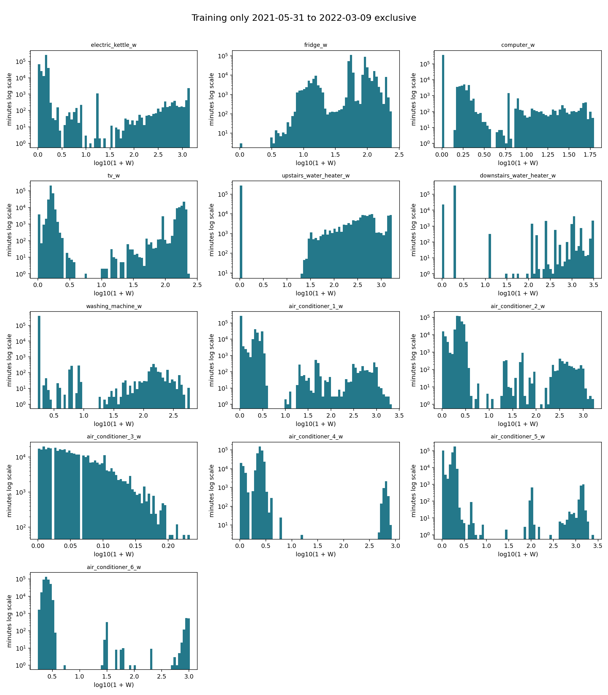
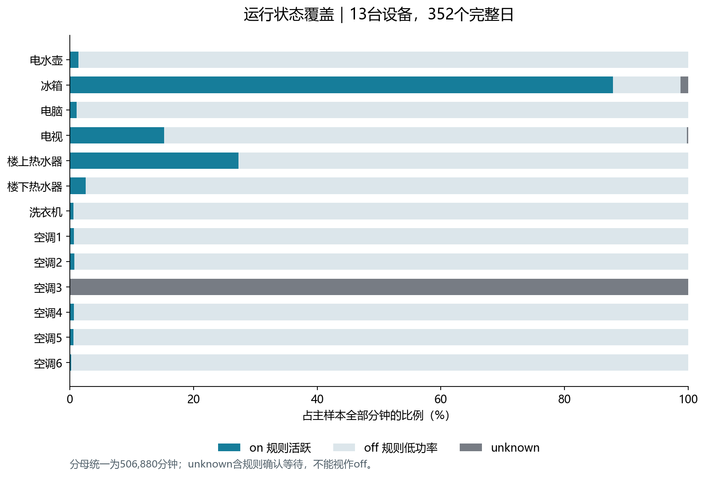
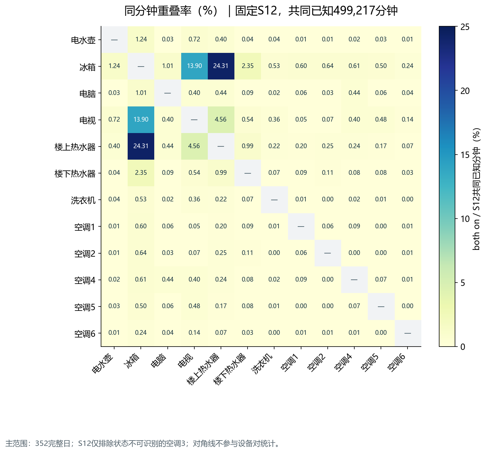
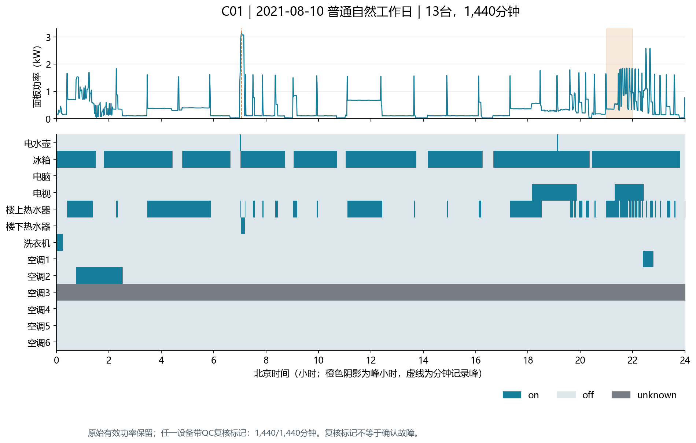
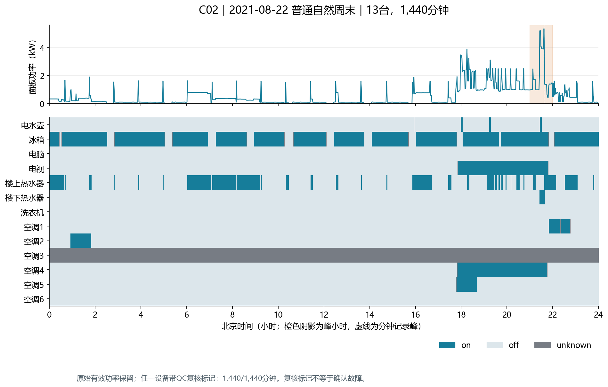
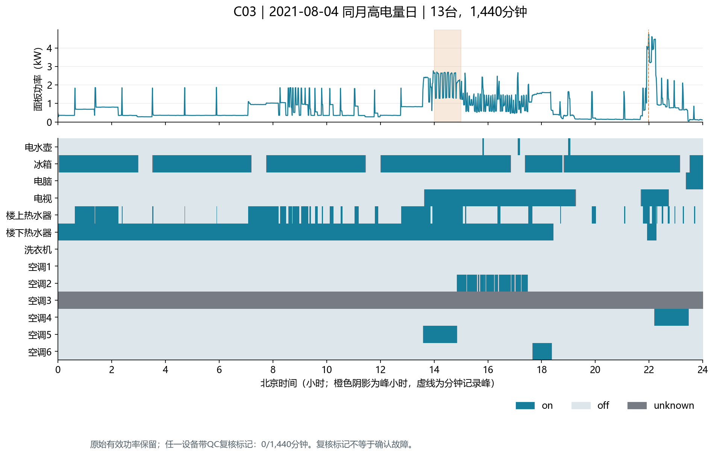
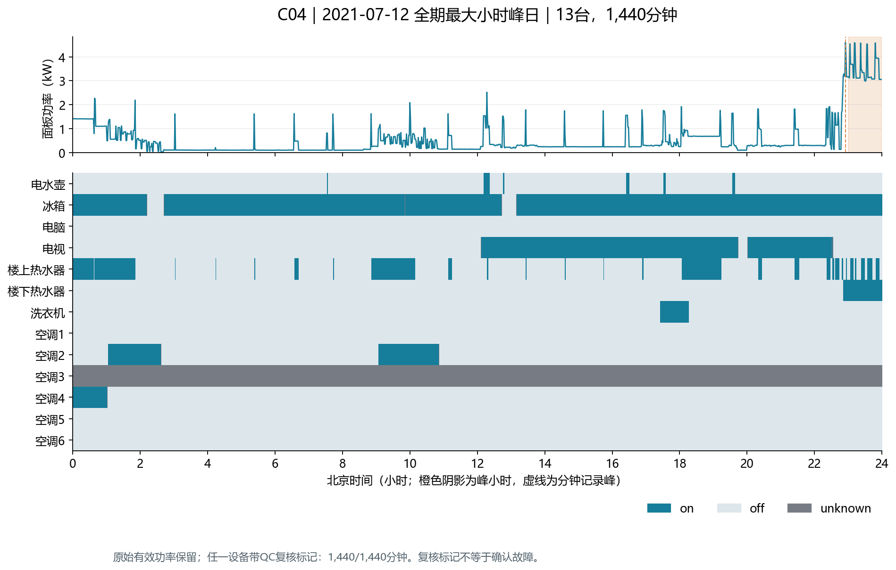
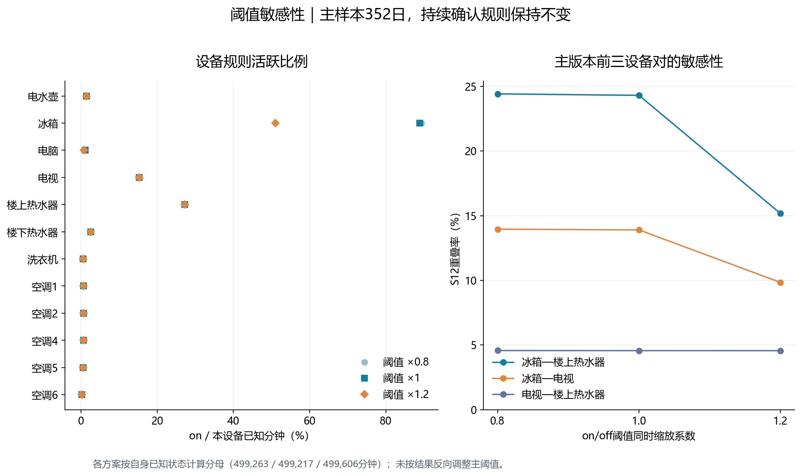

# Task05 第4—6步：电器运行判据、分钟状态与运行重叠

实验版本：task05_v1.0.1_20261117。分析对象：固定监测面板panel13（排除电饭煲），不等同于独立家庭总表。时间区间为北京时间[2021-05-31 00:00, 2022-06-01 00:00)。

2026-11-17仓库修订：全部共同有效分钟涉及日期分别为panel13的356日、panel14的153日；352/148为其中完整日数。正式表增加逐日支持与精确分钟掩码，原能量及峰值数值不变。

## 一、实验目标与分工衔接

本实验承接同伴task05前三步的输入锁定、同集合能量贡献、全部并列峰小时和四个固定案例，完成逐设备运行阈值、连续分钟状态及重叠统计。前三步来源快照与案例清单按字节保留，正式贡献表保留数值并修正日期元数据；本次新增审核、状态和重叠不改写原结果，也不重新挑选案例。

主结论：352个完整日中，固定可判定子集S12的共同已知分母为499,217分钟。其中187,147分钟至少两台设备处于规则on状态，占37.49%。主版本重叠率最高的设备对为冰箱与楼上热水器：121,359 / 499,217 = 24.31%。这些是特定电功率判据下的描述结果，不能当作有人工真值验证的压缩机状态、完整使用周期或住户行为记录。

重要限制：冰箱主阈值附近存在较多功率记录。将on/off阈值同时提高20%后，其规则on比例从88.88%降至51.04%，冰箱—楼上热水器重叠率从24.31%降至15.18%。因此，涉及冰箱的绝对运行时长和重叠强度应结合敏感性结果阅读，不宜作精确物理解释。

## 二、数据、样本与上游复核

| 用途 | 设备与范围 | 分钟/小时支持 | 说明 |
| --- | --- | --- | --- |
| 主贡献与主重叠 | panel13，352完整日 | 506,880分钟；8,448小时 | 固定日期与task02 day_complete逐项一致 |
| 贡献补充 | panel13全期共同有效 | 510,284分钟 | 独立贡献分母；约2,758.881648 kWh |
| 重叠补充 | panel13，完整日历轴 | 527,040分钟；8,784小时 | 保留缺口；各设备状态unknown另报 |
| 14台独立贡献补充 | panel14含电饭煲 | 217,643共同有效分钟；148完整日 | 原样继承，不进入本次运行子集 |
| 阈值制定 | 训练日历段[2021-05-31,2022-03-09) | 406,080日历分钟 | 仅以训练段分布与持续段证据手工制定规则 |

源数据为cn_obee_v1_noimpute_v1.0.0；功率单位W，分钟积分为ΣP/60000 kWh。本次不新增功率插补，不把缺测补0，不把发布记录等同于未处理的原始传感器事件。13份逐设备质量表的usable_value与宽表数值、缺测位置逐点一致；bit16/32仅保留复核，不自动删值。

独立对账确认：352日同集合分项电量与面板电量一致，约2739.597137333 kWh；8,448个主小时与8,503个全部严格有效小时均按相同时间键核对。继承的hourly_panel13.csv有4个不完整小时仍填有mean_power_kw，较新参考表将其留空。原文件保持不变，正式对账字段strict_target_kw强制按hour_complete置空，部分小时诊断均值不充当完整小时目标。

全部363个并列峰小时区间、原四案例和分钟记录峰继续保留。A/B记录为本次对上游的实现自查；未获取Task06模型实际运行产物，因此不声称完成了Task06负责人之间的交叉审核。

## 三、步骤四：逐设备运行判据

先检查训练期有效功率分位数、常见平台、长常值标记和不同候选阈值下的连续高功率段，再冻结规则。阈值是可审查的电功率层次划分，没有人工开关标签，未估计准确率或宣称最优。on阈值高于off阈值，两者之间保留最近已确认状态；不同设备采用不同确认长度。

| 设备 | on阈值W（≥） | off阈值W（≤） | on/off连续确认分钟 | on的含义 |
| --- | --- | --- | --- | --- |
| 电水壶 | 200 | 50 | 1 / 1 | 高功率加热代理 |
| 冰箱 | 50 | 20 | 2 / 2 | 较高功率运行代理 |
| 电脑 | 10 | 2 | 2 / 2 | 较高电活跃代理 |
| 电视 | 50 | 5 | 2 / 2 | 较高电活跃代理 |
| 楼上热水器 | 25 | 5 | 1 / 1 | 非待机加热功率代理 |
| 楼下热水器 | 100 | 20 | 1 / 1 | 高于待机的加热代理 |
| 洗衣机 | 5 | 1 | 1 / 1 | 分钟电活跃代理 |
| 空调1 | 150 | 20 | 1 / 2 | 高功率运行代理 |
| 空调2 | 150 | 20 | 1 / 2 | 高功率运行代理 |
| 空调3 | — | — | 1 / 1 | 无法识别运行状态 |
| 空调4 | 200 | 10 | 2 / 2 | 高功率运行代理 |
| 空调5 | 300 | 20 | 2 / 2 | 高功率运行代理 |
| 空调6 | 200 | 10 | 2 / 2 | 高功率运行代理 |

电水壶和加热设备保留1分钟可观测高功率脉冲；空调1/2的训练段也有较多1分钟高功率段，on采用1分钟确认。冰箱、电视、电脑和空调4/5/6采用2分钟确认。min_on/min_off在本实现中表示连续阈值证据长度，不保证输出状态段至少持续同样长度。

| 设备 | 训练期制定依据 |
| --- | --- |
| 电水壶 | 待机主要小于1W；>=200W训练段1143个，其中70个为1分钟，保留短脉冲。 |
| 冰箱 | 训练p25约52W，低平台集中5至20W；50/20W区分功率层次，不能验证压缩机状态或排除除霜。 |
| 电脑 | 训练90%为0W，5.29W有长常值；>=10W为较高活动层，不把待机或电脑实际使用视作已验证。 |
| 电视 | 待机主要0.5至1W，活跃主要100至205W；训练>=50W段无1分钟段。 |
| 楼上热水器 | 训练有276560分钟为0W，其余最小正平台约25W；20W候选段793个仅1分钟，保留短脉冲。 |
| 楼下热水器 | 待机1W占主导；>=100W段166个，其中6个1分钟；长常值只标复核，不删除。 |
| 洗衣机 | 待机约0.75W，>=5W训练2436分钟；只定义分钟活跃，不定义完整洗涤周期。 |
| 空调1 | 训练大部分0至2.4W；>=150W段557个，其中230个1分钟，保留高功率短段。 |
| 空调2 | 训练p99约22W，较低平台含风机候选；>=150W段644个，其中235个1分钟，保留。 |
| 空调3 | 训练最大0.71W，缺乏可辨识高功率平台；所有分钟运行状态unknown，功率仍计入panel13能量。 |
| 空调4 | 训练约1至2W待机与500至848W高平台分离；>=200W段29个，仅2个1分钟，用2分钟确认。 |
| 空调5 | 训练待机主要0至1.2W，50至200W另有低平台；>=300W段285个，其中4个1分钟，用2分钟确认。 |
| 空调6 | 训练待机约1至2W，高平台主要500至1034W；>=200W段28个，无1分钟段，用2分钟确认。 |



图1 训练期13台设备功率分布。横轴采用对数化功率刻度；阈值证据另见训练分位数、平台与持续段CSV。

## 四、步骤五：分钟状态与unknown

状态表保留连续527,040行，每台设备每分钟为on、off或unknown，并保留对应原因。起始状态为unknown；源缺测或无效值立即输出unknown并清空状态与确认计数。恢复观测后重新初始化，落在迟滞区间内仍为unknown，直至出现足够阈值证据。源功率完整不保证运行状态已知，因为规则还可能等待确认或本身不可识别。

```text
若源记录无效：unknown，重置稳定状态和候选计数
若设备不可识别：unknown
未初始化：连续达到on阈值确认on，连续低于off阈值确认off；区间内unknown
已确认off：达到on阈值开始on确认；其余有效记录保留off
已确认on：低于off阈值开始off确认；其余有效记录保留on
确认等待分钟：unknown；确认完成只赋当前分钟；历史分钟从不回填
```

状态判定仅使用截至当前分钟的证据；2分钟规则在首次阈值证据后需额外等待1分钟。候选中途取消时，过去等待分钟仍为unknown。该因果定义避免回填，但不代表数据已满足在线预测发布延迟要求；本次未将状态送入Task06，未来作为特征还须独立审核available_at。

| 原因码 | 含义 |
| --- | --- |
| 0 | 状态已知 |
| 1 | 源缺测或无效 |
| 2 | 运行状态不可识别 |
| 3 | 重置/起始后位于迟滞带，未能初始化 |
| 4 | 等待on连续证据确认 |
| 5 | 等待off连续证据确认 |

| 设备 | 已知分钟 | on分钟 | unknown分钟 | unknown/全部 | on/已知 | on中QC16/32分钟 |
| --- | --- | --- | --- | --- | --- | --- |
| 电水壶 | 506,880 | 7,106 | 0 | 0.00% | 1.40% | 0 / 0 |
| 冰箱 | 500,662 | 445,011 | 6,218 | 1.23% | 88.88% | 0 / 0 |
| 电脑 | 506,848 | 5,541 | 32 | 0.01% | 1.09% | 0 / 1,440 |
| 电视 | 505,823 | 77,137 | 1,057 | 0.21% | 15.25% | 0 / 0 |
| 楼上热水器 | 506,880 | 138,057 | 0 | 0.00% | 27.24% | 0 / 0 |
| 楼下热水器 | 506,880 | 13,081 | 0 | 0.00% | 2.58% | 0 / 1,440 |
| 洗衣机 | 506,880 | 2,915 | 0 | 0.00% | 0.58% | 0 / 0 |
| 空调1 | 506,733 | 3,313 | 147 | 0.03% | 0.65% | 0 / 0 |
| 空调2 | 506,796 | 3,584 | 84 | 0.02% | 0.71% | 0 / 0 |
| 空调3 | 0 | 0 | 506,880 | 100.00% | 不可定义 | 0 / 0 |
| 空调4 | 506,825 | 3,345 | 55 | 0.01% | 0.66% | 0 / 0 |
| 空调5 | 506,817 | 2,858 | 63 | 0.01% | 0.56% | 0 / 0 |
| 空调6 | 506,835 | 1,270 | 45 | 0.01% | 0.25% | 0 / 0 |

上表全部行的观测分母均为506,880分钟。空调3全部unknown，不能将其0个on分钟解释为未使用；其有效电量继续留在panel13。电脑和楼下热水器的on段各含1,440个长常值复核分钟，按要求保留；这会限制对活跃持续时长和个别案例的物理解释。



图2 主样本状态覆盖。off为规则低功率状态，不表示拔电、停用或无人。

另外保存全日历范围与逐月支持表，以及18,484个最大连续已确认on段。段边界可能由unknown打断；它们不是完整洗衣周期、一次入住或一次设备使用事件，不能直接将段数当作真实开机次数。

## 五、步骤六：运行重叠与统一分母

```text
设备对已知分母 N_known = 同一分钟i与j均非unknown的分钟数
共同on分钟 N_both = 已知集合内i与j都on的分钟数
重叠率 overlap_rate = N_both / N_known
条件比例 P(j on | i on) = N_both / N_i_on_known
Jaccard = N_both / N_union_on
任一指标自己的分母为0时留空；unknown不按off处理
```

overlap_summary.csv同时保留逐设备对分母pairwise_known，以及固定S12共同已知分母S12_common_known。前者方便查看每一对的可用支持，后者用于同范围横向排名。S12预先固定为panel13排除空调3后的12台，不能按结果高低再选择设备。

| 统计范围 | 比较集合 | 观测分钟 | 共同已知分钟 | unknown比例 | 至少2台on分钟 | 至少2台on比例 |
| --- | --- | --- | --- | --- | --- | --- |
| 352完整日 | panel13_all_known | 506,880 | 0 | 100.00% | 0 | 不可定义 |
| 352完整日 | S12_common_known | 506,880 | 499,217 | 1.51% | 187,147 | 37.49% |
| 全日历366日 | panel13_all_known | 527,040 | 0 | 100.00% | 0 | 不可定义 |
| 全日历366日 | S12_common_known | 527,040 | 502,578 | 4.64% | 188,350 | 37.48% |

全13台共同已知分钟数为0，因此全13台的重叠比例不可定义，不能填0或声称没有共同运行。主S12范围的共同未知比例为1.51%，这部分来自判据确认等待等状态不确定性，已经从分母中排除。全日历补充S12分母为502,578分钟，其不同于能量补充的510,284个共同有效功率分钟。

| 主排名 | 设备对 | 共同已知分钟 | 共同on分钟 | 重叠率 | P(j on ／ i on) | Jaccard |
| --- | --- | --- | --- | --- | --- | --- |
| 1 | 冰箱—楼上热水器 | 499,217 | 121,359 | 24.31% | 27.35% | 26.48% |
| 2 | 冰箱—电视 | 499,217 | 69,406 | 13.90% | 15.64% | 15.41% |
| 3 | 电视—楼上热水器 | 499,217 | 22,780 | 4.56% | 29.90% | 12.03% |
| 4 | 冰箱—楼下热水器 | 499,217 | 11,742 | 2.35% | 2.65% | 2.64% |
| 5 | 电水壶—冰箱 | 499,217 | 6,214 | 1.24% | 91.21% | 1.40% |
| 6 | 冰箱—电脑 | 499,217 | 5,049 | 1.01% | 1.14% | 1.14% |
| 7 | 楼上热水器—楼下热水器 | 499,217 | 4,925 | 0.99% | 3.62% | 3.42% |
| 8 | 电水壶—电视 | 499,217 | 3,579 | 0.72% | 52.53% | 4.51% |
| 9 | 冰箱—空调2 | 499,217 | 3,174 | 0.64% | 0.72% | 0.71% |
| 10 | 冰箱—空调4 | 499,217 | 3,056 | 0.61% | 0.69% | 0.69% |

排名以both_on/共同已知为准；表中条件比例与Jaccard只作不同含义的补充。冰箱有较高基础on比例，因此与其他设备重叠较多并不自动表示协同行为或因果关系。图3所有设备对使用相同499,217分钟，未把不同分母的设备对直接混排。



图3 S12同分钟重叠率热图；固定共同已知分母，单位%。完整66个设备对与逐对支持见正式CSV。

## 六、固定案例的状态与峰值解释

C01、C02、C03是原任务四同月案例，C04为全期最大小时峰日。各案例仅展示原日期的1,440分钟，不替代全期统计。自然周末与法定休息日沿用任务三不同字段，未合并为一个“工作日”标签。橙色峰小时与分钟峰位置来自原案例清单，不由状态重新选择。

### C01｜2021-08-10 普通自然工作日

原日能量8.697 kWh；最大小时均值0.831 kW；分钟记录峰3.154 kW。分钟峰同一分钟的最大功率贡献来自楼下热水器（96.70%）。S12共同已知1,417分钟，其中至少两台规则on为655分钟（46.22%）。



图4-C01 原始面板曲线与13台分钟状态；峰时与复核标记保留。

### C02｜2021-08-22 普通自然周末

原日能量11.909 kWh；最大小时均值1.899 kW；分钟记录峰5.333 kW。分钟峰同一分钟的最大功率贡献来自楼下热水器（54.60%）。S12共同已知1,407分钟，其中至少两台规则on为617分钟（43.85%）。



图4-C02 原始面板曲线与13台分钟状态；峰时与复核标记保留。

### C03｜2021-08-04 同月高电量日

原日能量18.373 kWh；最大小时均值2.102 kW；分钟记录峰4.753 kW。分钟峰同一分钟的最大功率贡献来自楼下热水器（62.74%）。S12共同已知1,406分钟，其中至少两台规则on为1,200分钟（85.35%）。



图4-C03 原始面板曲线与13台分钟状态；峰时与复核标记保留。

### C04｜2021-07-12 全期最大小时峰日

原日能量13.065 kWh；最大小时均值3.439 kW；分钟记录峰4.613 kW。分钟峰同一分钟的最大功率贡献来自楼下热水器（63.61%）。S12共同已知1,427分钟，其中至少两台规则on为936分钟（65.59%）。



图4-C04 原始面板曲线与13台分钟状态；峰时与复核标记保留。

小时峰与分钟峰常处于不同时间，能量贡献与规则on也不是同一量。2分钟确认设备在高功率首次出现时可暂为unknown，不能为使峰图“对齐”而回填。C04的23:00峰小时代表[23:00,次日00:00)，没有把起点标签错作区间结束。

## 七、阈值敏感性与解释边界

规则冻结时预先规定on/off阈值同时乘0.8、1.0、1.2，持续确认长度不变。仅作描述性敏感性检查，没有根据全年结果挑选阈值。各方案仍在同一352日范围内，但确认等待会让S12共同已知分钟数分别为499,263、499,217、499,606；下表按各自已知分母计算，不把它们称为逐分钟完全相同的集合。

| 设备 | 阈值×0.8：on/已知 | 主阈值：on/已知 | 阈值×1.2：on/已知 |
| --- | --- | --- | --- |
| 电水壶 | 1.41% | 1.40% | 1.40% |
| 冰箱 | 89.32% | 88.88% | 51.04% |
| 电脑 | 1.10% | 1.09% | 0.79% |
| 电视 | 15.25% | 15.25% | 15.25% |
| 楼上热水器 | 27.25% | 27.24% | 27.23% |
| 楼下热水器 | 2.58% | 2.58% | 2.58% |
| 洗衣机 | 0.58% | 0.58% | 0.57% |
| 空调1 | 0.70% | 0.65% | 0.63% |
| 空调2 | 0.73% | 0.71% | 0.63% |
| 空调3 | 不可定义 | 不可定义 | 不可定义 |
| 空调4 | 0.66% | 0.66% | 0.66% |
| 空调5 | 0.56% | 0.56% | 0.56% |
| 空调6 | 0.25% | 0.25% | 0.25% |

| 主版本前三设备对 | 阈值×0.8重叠率 | 主阈值重叠率 | 阈值×1.2重叠率 |
| --- | --- | --- | --- |
| 冰箱—楼上热水器 | 24.43% | 24.31% | 15.18% |
| 冰箱—电视 | 13.96% | 13.90% | 9.84% |
| 电视—楼上热水器 | 4.57% | 4.56% | 4.56% |



图5 阈值敏感性。冰箱变化明显；其余设备对是否稳定应查询全量敏感性CSV，不从前三名推广到全部设备。

三种方案的前三设备对顺序相同，但冰箱—楼上热水器重叠率提高阈值后下降约9.13个百分点，不能以排名未变声称绝对重叠强度稳健。阈值敏感性不等同于准确率验证；仍需要独立的设备运行标签来验证物理状态。

## 八、验收、复现与交付

生产状态机之外，独立核验程序采用连续阈值证据长度与最近确认/重置事件重建全期状态，逐点比较6,851,520个状态及其原因；另检查91个历史前缀的一致性和13个边界单元测试。核验还覆盖所有288行重叠、零分母留空、QC保留、案例同时性、连续on段、敏感性以及前三步正式文件哈希。最终通过项数和详情以verification_task05.json及核验结果.md为准。

C节点先于全期状态生成，冻结阈值、四类合成短样例和边界测试。A/B及C均为自动实现自查，未冒充外部人工审核。无功率新增插补、无缺口压缩、无跨缺口延续；正式贡献表原数值与原案例文件保持一致。

```text
在仓库根目录运行（环境见requirements.txt）：
python task05/verify_task05.py

完整复算六步：
python task05/run_all.py

后三步分步重算：
python task05/inspect_training.py
python task05/freeze_rules.py
python task05/audit_rules.py
python task05/run_task05.py
python task05/report_task05.py
python task05/make_manifest.py
python task05/verify_task05.py
```

完整包内置所需冻结输入；首次复跑不需要访问原E盘来源目录或联网。CSV为UTF-8（普通CSV带BOM，gzip CSV为UTF-8）；比率储存为0—1数值，零分母为空。请将reports内实验报告用于正文撰写，按DATA_DICTIONARY.md解释字段；inputs/first_three保留原贡献程序、说明与证据，来源归属清楚。

本次整合并核对Task05六步，修正样本元数据；详见验收修订说明。未实施Task06训练或把状态加入预测，也不将本次2021年案例替换Task06的2022年固定测试期。
