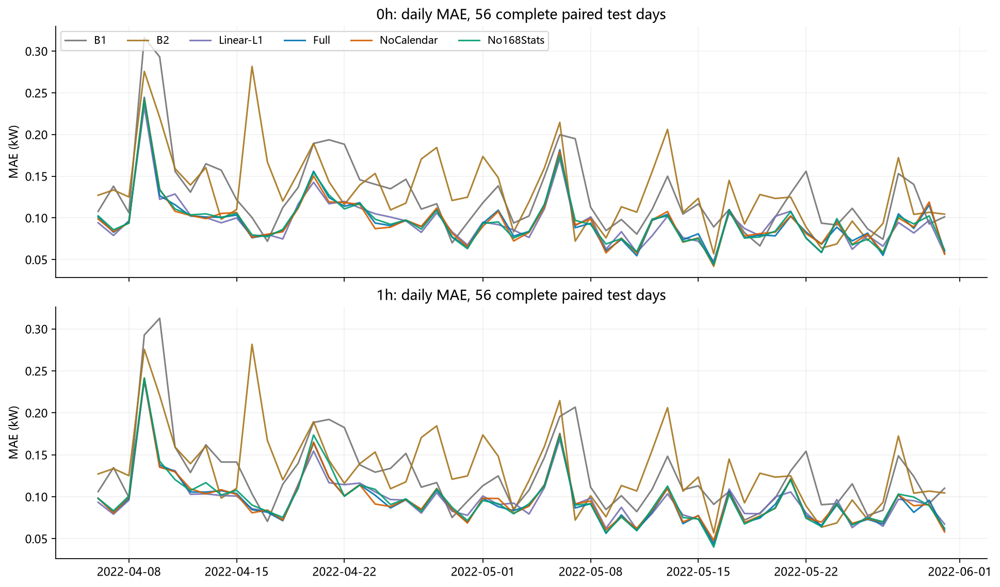
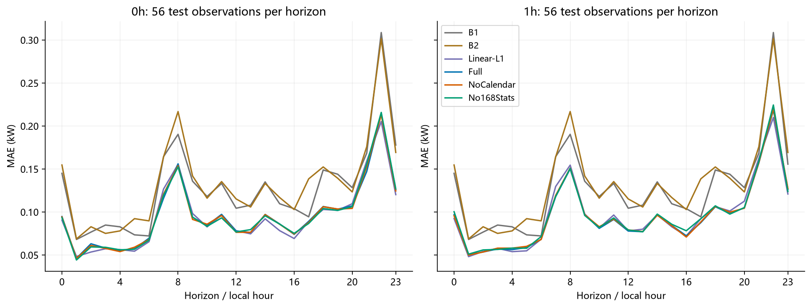
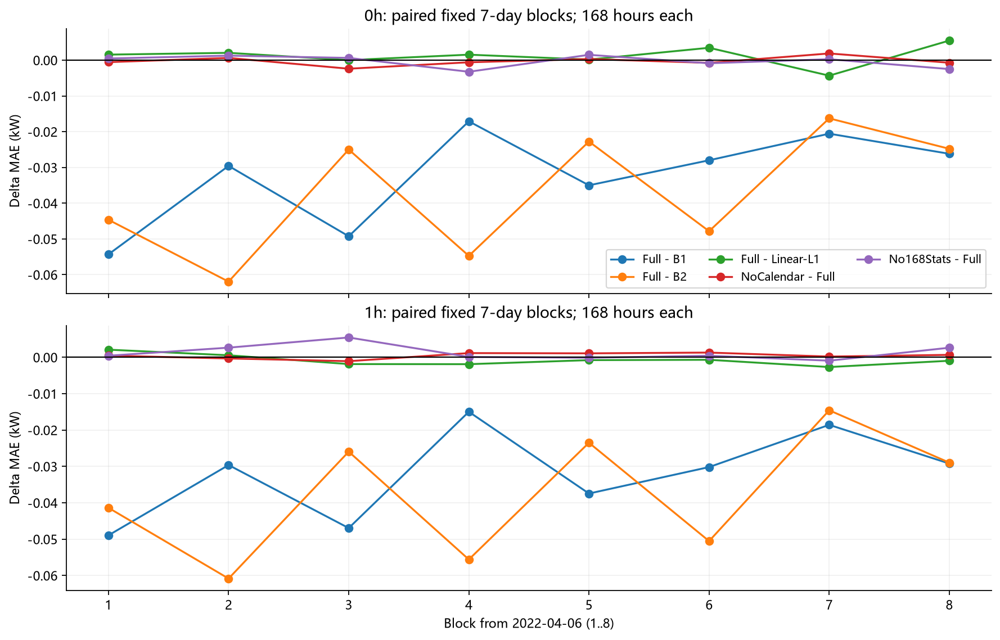
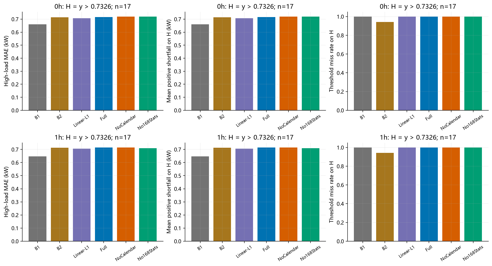
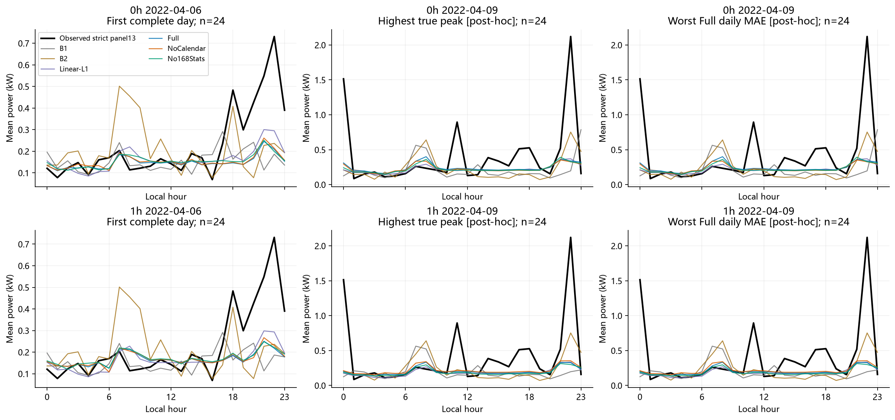

# task06 条件性日前预测实验报告


版本 `task06_v1.0.0_20261118`。实际起点提交 `3bc432cd85f2d233d166e7d186b1b450e7c48f20`；独立分支 `task06/day-ahead-audit-20261118`。

设计规定已整理至 DESIGN.md；六种方法、双延迟、可获知性、固定掩码、独立选参、一次重训、10000 次四算法配对 bootstrap 已实现并实际运行。已独立核验通过：12 组验收，失败 0。


下面的框架综合了预测评价论文和 NeurIPS 官方清单，是针对你这个任务整理的检查方法，不是文献中的统一评分量表。预测评价论文明确讨论了基线、切分、指标、泄漏和统计比较；NeurIPS 清单则强调结论范围、实验细节、局限性与可复现性。


## 数据与信息边界


固定 cn_obee_v1_noimpute_v1.0.0，panel13/v1.0.0，排除电饭煲。目标为 13 台监测设备合计功率的小时内时间平均，单位 kW，不是设备间平均或独立整户电表。连续 8784 小时、8503 严格有效小时和 281 缺口全部保留。数据输入版本、实际路径和 SHA-256 见 input_manifest.json。

训练 [2021-05-31,2022-03-09)，验证 [2022-03-09,2022-04-06)，测试 [2022-04-06,2022-06-01)，每天北京时间 00:00 发布 24h。发布只依赖可获知历史和已公开日历，未来目标完整性仅参与评分与已发生标签拟合。


| scenario | split | calendar_origins | release_origins | complete_target_origins | score_origins | score_hours | initial_fit_origins | refit_origins | validation_selection_origins |
| --- | --- | --- | --- | --- | --- | --- | --- | --- | --- |
| 0h | train | 282 | 254 | 268 | 253 | 6072 | 253 | 253 | 0 |
| 0h | validation | 28 | 28 | 28 | 28 | 672 | 0 | 28 | 28 |
| 0h | test | 56 | 56 | 56 | 56 | 1344 | 0 | 0 | 0 |
| 1h | train | 282 | 254 | 268 | 253 | 6072 | 252 | 253 | 0 |
| 1h | validation | 28 | 28 | 28 | 28 | 672 | 0 | 27 | 27 |
| 1h | test | 56 | 56 | 56 | 56 | 1344 | 0 | 0 | 0 |


0h 初始拟合 253 天 / 6072 行，选参 28 天 / 672 行，重训 281 天 / 6744 行；1h 初始拟合 252 天 / 6048 行，选参 27 天 / 648 行，重训 280 天 / 6720 行。两场景测试均 56 天 / 1344 小时，8 个固定周块。1h 最后一个训练日和最后一个验证日的末标签在相应午夜尚未发布；完整日保守规则排除整日，事后验证仍完整报告 28 天。

2021/2022 日历网页分别公开于 2020-11-26、2021-10-25；未知时分时保守假设次日 00:00 可用。notice_date 原字节不改，新增 public_date/public_available_at 并审计。1h 的 h=23 昨日同期改为前日同期，B1 名称为 lag24_else_lag48；所有学习模型同步。无真实缺失临时回填。


## 冻结模型与验证


一个共享 horizon 模型，20 个信息字段统一固定 one-hot 为 78 维；Linear-L1 只在当前拟合段学习数值缩放。训练候选仅用初始训练段，验证选参只用截至 test_start 已发布的完整验证日。近似并列容差 1e-12；线性优先强正则，树模型依次优先少树、少叶、大最小叶样本。消融固定 Full 参数。

```json
{
  "0h": {
    "Linear-L1": {
      "alpha": 0.001
    },
    "Full": {
      "n_estimators": 200,
      "num_leaves": 15,
      "min_child_samples": 40
    }
  },
  "1h": {
    "Linear-L1": {
      "alpha": 0.001
    },
    "Full": {
      "n_estimators": 200,
      "num_leaves": 15,
      "min_child_samples": 80
    }
  }
}
```


最终冻结文件 SHA-256：`aac37411f953c5ebe18820286a2c1b9b04d0a6981588f2a5ca9f11dcbd83da94`。首次测试预测前已保存；每场景重训一次，测试固定模型。真实验证预测来自初始模型，未用重训模型回填。训练集结果单列 fit_diagnostic，不作样本外证据。raw 与 max(raw,0) 及截断数均保存。

候选验证 MAE、求解状态、耗时见 validation_search.csv；模型、处理器、拟合支持和截止见 model_stage_index.csv 与 training_log.jsonl。


## 测试总体与稳定改善


| scenario | model | n_hours | n_days | MAE_kw | RMSE_kw |
| --- | --- | --- | --- | --- | --- |
| 0h | B1 | 1344 | 56 | 0.128200 | 0.201675 |
| 0h | B2 | 1344 | 56 | 0.132949 | 0.203982 |
| 0h | Linear-L1 | 1344 | 56 | 0.094460 | 0.148816 |
| 0h | Full | 1344 | 56 | 0.095704 | 0.149471 |
| 0h | NoCalendar | 1344 | 56 | 0.095434 | 0.149877 |
| 0h | No168Stats | 1344 | 56 | 0.095396 | 0.149995 |
| 1h | B1 | 1344 | 56 | 0.127276 | 0.200445 |
| 1h | B2 | 1344 | 56 | 0.132949 | 0.203982 |
| 1h | Linear-L1 | 1344 | 56 | 0.096057 | 0.149566 |
| 1h | Full | 1344 | 56 | 0.095287 | 0.150028 |
| 1h | NoCalendar | 1344 | 56 | 0.095727 | 0.149682 |
| 1h | No168Stats | 1344 | 56 | 0.096622 | 0.150584 |


| scenario | comparison | point_estimate | ci_low | ci_high | valid_repetitions |
| --- | --- | --- | --- | --- | --- |
| 0h | Full-B1 | -0.032495 | -0.041427 | -0.024446 | 10000 |
| 0h | Full-B2 | -0.037244 | -0.048289 | -0.026583 | 10000 |
| 0h | Full-Linear-L1 | 0.001244 | -0.000673 | 0.002981 | 10000 |
| 0h | NoCalendar-Full | -0.000270 | -0.001085 | 0.000552 | 10000 |
| 0h | No168Stats-Full | -0.000308 | -0.001494 | 0.000738 | 10000 |
| 1h | Full-B1 | -0.031989 | -0.039824 | -0.024195 | 10000 |
| 1h | Full-B2 | -0.037661 | -0.048559 | -0.026981 | 10000 |
| 1h | Full-Linear-L1 | -0.000770 | -0.001679 | 0.000286 | 10000 |
| 1h | NoCalendar-Full | 0.000439 | -0.000118 | 0.000937 | 10000 |
| 1h | No168Stats-Full | 0.001335 | 0.000090 | 0.002799 | 10000 |


| scenario | baseline | delta_MAE_kw | ci_low | ci_high | winning_weeks | total_weeks | daily_win_rate | tied_days | daily_delta_median_kw | worst_week | worst_week_delta_kw | stable_improvement | practical_qualification |
| --- | --- | --- | --- | --- | --- | --- | --- | --- | --- | --- | --- | --- | --- |
| 0h | B1 | -0.032495 | -0.041427 | -0.024446 | 8 | 8 | 0.928571 | 0 | -0.027550 | 3 | -0.017103 | True | not_defined |
| 0h | B2 | -0.037244 | -0.048289 | -0.026583 | 8 | 8 | 0.892857 | 0 | -0.035200 | 6 | -0.016272 | True | not_defined |
| 1h | B1 | -0.031989 | -0.039824 | -0.024195 | 8 | 8 | 0.928571 | 0 | -0.026817 | 3 | -0.014974 | True | not_defined |
| 1h | B2 | -0.037661 | -0.048559 | -0.026981 | 8 | 8 | 0.892857 | 0 | -0.033091 | 6 | -0.014567 | True | not_defined |


主差值为 Full−比较方法，负值代表 Full 的 MAE 更低；消融差值为消融−Full，正值代表 Full 更好。稳定改善对两条基线分别要求总体负差、配对周块区间上界<0、至少 6/8 周负差。6/8 为本项目预设操作规则，不是通用显著性检验。

实际用途阈值、τ_U/τ_P/τ_T、p_day/p_high、实际改善量与非劣界限全部未定义，不判绝对合格、等效或不劣，也不使用 5% 作为实际资格线。


## 高负荷与低估风险


H 为共同小时中 y>0.7326097666666669 kW，阈值直接承接最初训练段 6487 严格小时，未用 6072 行模型集合重新拟合。

| scenario | model | n_H | n_H_days | n_H_week_blocks | MAE_H_kw | Bias_H_kw | U_H_kw | under_rate_H | conditional_gap_H_kw | gap_q90_H_kw | FNR_H | over_mean_all_kw |
| --- | --- | --- | --- | --- | --- | --- | --- | --- | --- | --- | --- | --- |
| 0h | B1 | 17 | 11 | 6 | 0.660715 | -0.660715 | 0.660715 | 1.000000 | 0.660715 | 1.065545 | 1.000000 | 0.063959 |
| 0h | B2 | 17 | 11 | 6 | 0.713818 | -0.713818 | 0.713818 | 1.000000 | 0.713818 | 1.070222 | 0.941176 | 0.067015 |
| 0h | Linear-L1 | 17 | 11 | 6 | 0.707139 | -0.707139 | 0.707139 | 1.000000 | 0.707139 | 0.938210 | 1.000000 | 0.033362 |
| 0h | Full | 17 | 11 | 6 | 0.716340 | -0.716340 | 0.716340 | 1.000000 | 0.716340 | 0.932992 | 1.000000 | 0.036531 |
| 0h | NoCalendar | 17 | 11 | 6 | 0.720044 | -0.720044 | 0.720044 | 1.000000 | 0.720044 | 0.941838 | 1.000000 | 0.035908 |
| 0h | No168Stats | 17 | 11 | 6 | 0.719120 | -0.719120 | 0.719120 | 1.000000 | 0.719120 | 0.962928 | 1.000000 | 0.035663 |
| 1h | B1 | 17 | 11 | 6 | 0.646684 | -0.646684 | 0.646684 | 1.000000 | 0.646684 | 1.065545 | 1.000000 | 0.063451 |
| 1h | B2 | 17 | 11 | 6 | 0.713818 | -0.713818 | 0.713818 | 1.000000 | 0.713818 | 1.070222 | 0.941176 | 0.067015 |
| 1h | Linear-L1 | 17 | 11 | 6 | 0.706869 | -0.706869 | 0.706869 | 1.000000 | 0.706869 | 0.970227 | 1.000000 | 0.036724 |
| 1h | Full | 17 | 11 | 6 | 0.714935 | -0.714935 | 0.714935 | 1.000000 | 0.714935 | 0.970719 | 1.000000 | 0.034706 |
| 1h | NoCalendar | 17 | 11 | 6 | 0.715396 | -0.715396 | 0.715396 | 1.000000 | 0.715396 | 0.960859 | 1.000000 | 0.036204 |
| 1h | No168Stats | 17 | 11 | 6 | 0.709015 | -0.709015 | 0.709015 | 1.000000 | 0.709015 | 0.986009 | 1.000000 | 0.037678 |


低估发生率是预测低于真实；FNR_H 是高负荷小时预测未超过阈值，两者不能混同。gap_q90 包含所有高负荷小时的零缺口。U_H 是全部 H 小时平均正缺口；只有发生低估的小时才进入条件平均缺口。各周高负荷数量和 NA 原因见 high_load_metrics.csv 与 weekly_metrics.csv。


## 日峰值


| scenario | model | peak_abs_kw | peak_under_kw | true_peak_gap_kw | peak_time_h | peak_time_circular_h | true_flat_days | pred_flat_days | days |
| --- | --- | --- | --- | --- | --- | --- | --- | --- | --- |
| 0h | B1 | 0.218864 | 0.109792 | 0.354874 | 8.428571 | 6.392857 | 0 | 0 | 56 |
| 0h | B2 | 0.237962 | 0.116568 | 0.351485 | 7.928571 | 5.892857 | 0 | 0 | 56 |
| 0h | Linear-L1 | 0.278716 | 0.276183 | 0.381343 | 8.232143 | 6.053571 | 0 | 0 | 56 |
| 0h | Full | 0.295764 | 0.290630 | 0.378922 | 8.446429 | 6.196429 | 0 | 0 | 56 |
| 0h | NoCalendar | 0.293326 | 0.289002 | 0.380527 | 8.839286 | 6.375000 | 0 | 0 | 56 |
| 0h | No168Stats | 0.285345 | 0.279502 | 0.381453 | 7.625000 | 5.625000 | 0 | 0 | 56 |
| 1h | B1 | 0.218561 | 0.107395 | 0.355783 | 9.535714 | 6.964286 | 0 | 0 | 56 |
| 1h | B2 | 0.237962 | 0.116568 | 0.351485 | 7.928571 | 5.892857 | 0 | 0 | 56 |
| 1h | Linear-L1 | 0.278258 | 0.274338 | 0.375557 | 8.232143 | 6.017857 | 0 | 0 | 56 |
| 1h | Full | 0.289106 | 0.283302 | 0.378621 | 8.000000 | 5.857143 | 0 | 0 | 56 |
| 1h | NoCalendar | 0.284311 | 0.278093 | 0.374649 | 7.732143 | 5.732143 | 0 | 0 | 56 |
| 1h | No168Stats | 0.285234 | 0.278304 | 0.373871 | 7.946429 | 5.839286 | 0 | 0 | 56 |


精确 float64 并列；预测取最早峰，对所有真实峰取最小普通小时差为主。环形距离只作补充。真实平坦日时差 NA，幅度保留；预测平坦仍保留并取 0 点。逐日真实/预测峰集合、并列数、平坦标记和全部预测并列到真实峰的平均最近距离见 daily_peak_metrics.csv。


## 风险比较与消融


0h Full−B1 高负荷差：MAE_H_kw=+0.055626, U_H_kw=+0.055626, FNR_H=+0.000000；峰值差：peak_abs_kw=+0.076900, peak_under_kw=+0.180837, peak_time_h=+0.017857。上述误差/风险差为正代表恶化。

0h Full−B2 高负荷差：MAE_H_kw=+0.002522, U_H_kw=+0.002522, FNR_H=+0.058824；峰值差：peak_abs_kw=+0.057802, peak_under_kw=+0.174061, peak_time_h=+0.517857。上述误差/风险差为正代表恶化。

1h Full−B1 高负荷差：MAE_H_kw=+0.068251, U_H_kw=+0.068251, FNR_H=+0.000000；峰值差：peak_abs_kw=+0.070545, peak_under_kw=+0.175907, peak_time_h=-1.535714。上述误差/风险差为正代表恶化。

1h Full−B2 高负荷差：MAE_H_kw=+0.001118, U_H_kw=+0.001118, FNR_H=+0.058824；峰值差：peak_abs_kw=+0.051144, peak_under_kw=+0.166734, peak_time_h=+0.071429。上述误差/风险差为正代表恶化。

即使整体 MAE 更低，高负荷或峰值指标恶化仍须单独披露，不能据总体结果宣称峰值场景可靠。消融回答当前 Full 参数配置下删除特征组的影响；即使某消融测试更好，也不回头替换主模型。


| scenario | split | left_model | right_model | metric | difference | relative_improvement | relative_reason |
| --- | --- | --- | --- | --- | --- | --- | --- |
| 0h | test | NoCalendar | Full | MAE_kw | -0.000270 | 0.002826 | NA |
| 0h | test | NoCalendar | Full | RMSE_kw | 0.000406 | -0.002720 | NA |
| 0h | test | No168Stats | Full | MAE_kw | -0.000308 | 0.003220 | NA |
| 0h | test | No168Stats | Full | RMSE_kw | 0.000524 | -0.003508 | NA |
| 1h | test | NoCalendar | Full | MAE_kw | 0.000439 | -0.004609 | NA |
| 1h | test | NoCalendar | Full | RMSE_kw | -0.000346 | 0.002304 | NA |
| 1h | test | No168Stats | Full | MAE_kw | 0.001335 | -0.014008 | NA |
| 1h | test | No168Stats | Full | RMSE_kw | 0.000556 | -0.003705 | NA |


跨场景比较见 information_sensitivity.csv，使用两场景交集重新计算；不同场景独立拟合，不复用模型。


## 时间块区间与限制


主算法有放回抽 8 个不重叠连续 7 日块；移动日块敏感性 L=3/7/14，均不环绕，拼接后截取 56 日。每项每算法每场景 B=10000、seed=42，全部方法配对使用同一日索引。重算平方误差与子集分子分母，不平均周 RMSE 或高负荷 MAE；q90 使用整数重复权重的精确线性分位数。有效重复不足 95% 不发布区间。完整结果及有效次数见 uncertainty_summary.csv，索引和部分重抽样指标留供独立核验。

小时、日期、周块均未经证明相互独立；10000 次重抽样不是 10000 份新数据。本版未估计 N_eff；只有 8 块，跨周依赖和非平稳性限制区间解释。多 horizon 与消融的逐项区间不是同时成立的显著性结论。区间跨零不等于等效，评价差值区间不是未来负荷预测区间。


## 图表与案例


以下图表全部为测试集。无缺口时完整绘制；绘图数据按真实日历重建并保留 NaN，缺口不连线。支持数写在图内。案例规则在测试前固定，最高真实峰和 Full 最差日属于事后诊断，不能代表整体证据。












## 实际运行与核验


在仓库根目录，实际使用专用环境执行：


```powershell
& ..\.venv\Scripts\python.exe task06/run_task06.py prepare
& ..\.venv\Scripts\python.exe task06/run_task06.py preflight
& ..\.venv\Scripts\python.exe -m pytest task06/tests -q
& ..\.venv\Scripts\python.exe task06/run_task06.py train
& ..\.venv\Scripts\python.exe task06/run_task06.py predict
& ..\.venv\Scripts\python.exe task06/run_task06.py evaluate
& ..\.venv\Scripts\python.exe task06/run_task06.py report
& ..\.venv\Scripts\python.exe task06/run_task06.py verify
& ..\.venv\Scripts\python.exe task06/run_task06.py manifest
```


已独立核验通过：12 组验收，失败 0。

核验采用已保存 CSV 的独立算术、人工反例、合法冻结模型的未来记录删除/扰动不变性实验、目标缺口/QC 改动、全部模型加载复现与上游原字节检查；同一环境中的独立代码路径不代表外部人员审阅。详见 verification_task06.json。

独立目录从输入开始的一键复跑也已完成：观测阶段跨度 301.489 秒，另一次训练/选参/重训仍按同一冻结规则运行，12 份关键表与主实验逐字节一致，含 105408 行全位置预测。详情见 reproduction_check.json。


## 资源与结论范围


本地资源实测与推算分列于 resource_report.md；CPU 预检已完成，无需云 CPU 或 GPU。最终 bootstrap 不重复拟合，也没有减少正式次数。

本项目新增插补 0，不等于上游从未填补；逐点上游填补身份 unknown。这是固定发布数据、固定面板和声明可用性假设下的条件性日前回测。真实部署可用性仍需在线日志验证。测试仅覆盖 2022-04-06 至 05-31，不能声称全年或跨家庭有效。设计参考过上游全期描述性成果，具有回顾性探索背景。离线数据截止不等于已经模拟真实训练耗时和服务发布延迟。

源数据未知的上游填补和真实部署日志不是本版已解决问题；全部已计划实现/运行/核验状态以实际日志为准。主分支由用户合并。


## 参考资料


- [预测评价方法](https://link.springer.com/article/10.1007/s10618-022-00894-5)

- [NeurIPS 官方清单](https://neurips.cc/public/guides/PaperChecklist)

- [LightGBM 调参](https://lightgbm.readthedocs.io/en/stable/Parameters-Tuning.html)

- [LightGBM GPU 性能](https://lightgbm.readthedocs.io/en/stable/GPU-Performance.html)

- [QuantileRegressor](https://scikit-learn.org/stable/modules/generated/sklearn.linear_model.QuantileRegressor.html)

- [CN-OBEE 数据论文](https://www.nature.com/articles/s41597-023-02891-9)

- [2021 官方安排](https://app.www.gov.cn/govdata/gov/202011/26/465359/article.html)

- [2022 官方安排](https://app.www.gov.cn/govdata/gov/202110/25/477434/article.html)